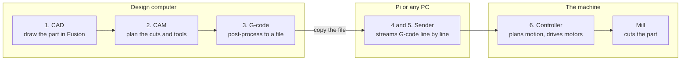
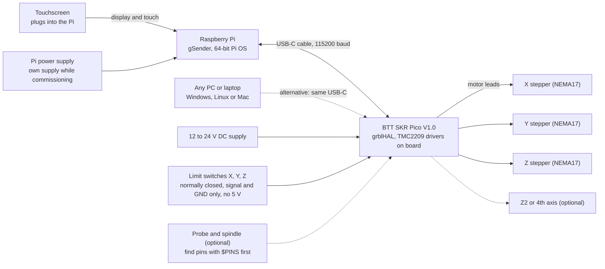
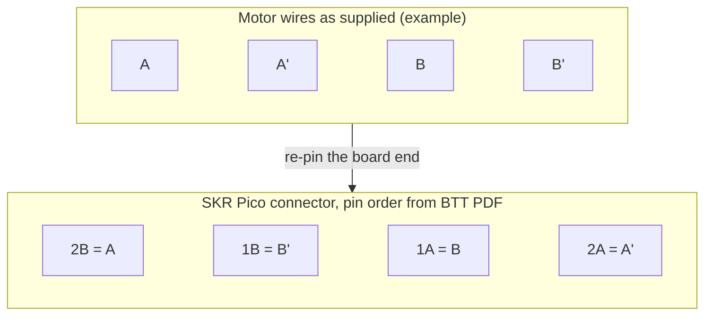
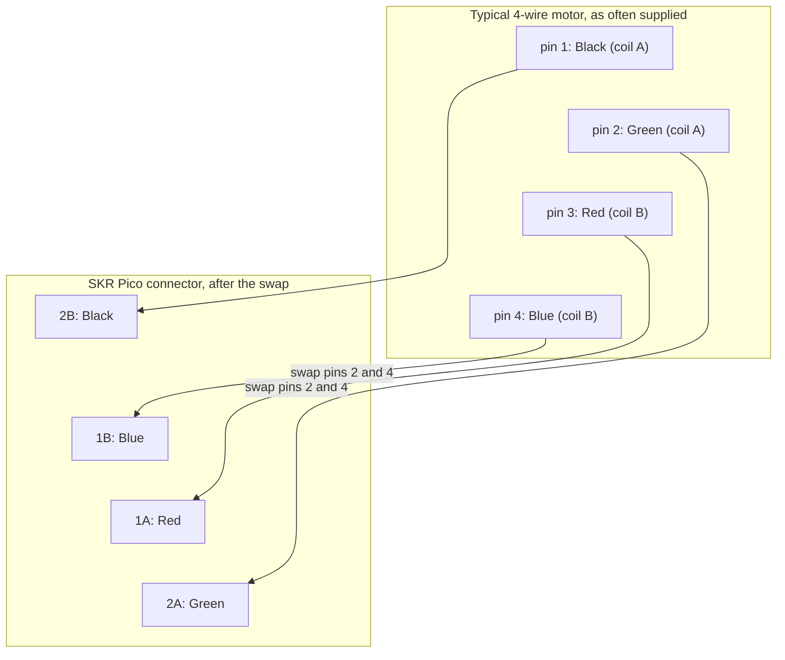

# grblHAL on BTT SKR Pico: CNC mill controller setup guide

*Written 26 Nov 2026.* A step-by-step guide for people who know Marlin/Klipper printers, covering an SKR Pico V1.0 running grblHAL with a Raspberry Pi sender.

## From drawing to cut part: how the pieces fit

A CNC mill makes a part through a chain of hand-offs. Each stage hands a file or a stream to the next, so knowing which stage does which job makes faults much easier to find. This guide builds stages 4 to 6; stages 1 to 3 happen in your CAD and CAM software.



The G-code file is copied to wherever the sender runs. If the sender runs on the design computer, no copy is needed.

1. **CAD: draw the part.** You model the part on screen. This guide's example is Autodesk Fusion, which has a free version for personal use, aimed at hobbyists and people making under US$1,000 a year from their work ([Autodesk](https://www.autodesk.com/products/fusion-360/blog/fusion-for-personal-use-vs-autodesk-fusion/), [terms](https://www.autodesk.com/campaigns/fusion-360-personal-use-changes)). **Check before you plan around a browser:** I could not confirm that the personal-use version runs in a web browser. Autodesk's help says access to the Fusion web client is not included with personal-use or trial versions ([Autodesk help](https://help.autodesk.com/cloudhelp/ENU/Fusion-GetStarted/files/FT-WEB-CLIENT.htm)). A separate partner article describes a browser version with the full toolset, but its list of eligible licences names commercial, startup and education users and does not mention personal use ([Arkance](https://ukcommunity.arkance.world/hc/en-us/articles/35549401706642-How-to-use-Autodesk-Fusion-directly-in-your-web-browser)). Until you have checked with Autodesk, plan on the desktop app for Windows or macOS. Any CAD and CAM package that can output Grbl-style G-code follows the same process (my note).
2. **CAM: plan the cuts.** CAD holds the shape; CAM decides how to cut it: the stock, the tools, the speeds and the toolpaths. Autodesk lists "limited CAM functionality" and "limited import/export file types" for the personal-use version without saying which ([Autodesk](https://www.autodesk.com/campaigns/fusion-360-personal-use-changes)). A third-party add-in author states that the free version does not support tool changes and slows all moves to feed rate ([Batch Post add-in](https://github.com/TimPaterson/Fusion360-Batch-Post)). I have not verified whether that still holds, so check Autodesk's current limits before relying on rapid moves or tool changes.
3. **Post-process: write the G-code.** A post processor converts the toolpaths into G-code for one particular type of machine ([Autodesk](https://www.autodesk.com/products/fusion-360/blog/fusion-360-grbl-post/)). Fusion ships with generic posts and has an online library of more ([Autodesk help](https://help.autodesk.com/cloudhelp/ENU/Fusion-CAM/files/MFG-POST-PROCESSING-OVERVIEW.htm)). Choose the Grbl post, since grblHAL speaks Grbl-style G-code, and test with a simple shape first, as Autodesk advises ([Autodesk](https://www.autodesk.com/products/fusion-360/blog/?p=13395)). The result is a plain text file. Read it before you run it: check the spindle and tool-change lines match how you run the machine (my note).
4. **Copy the G-code to the machine that runs the sender.** Move the file by USB stick, network share or any other file transfer to the Pi (or whichever computer runs gSender). If the sender runs on the same PC as Fusion, there is nothing to copy. Then open the file in the sender.
5. **Sender: stream the file.** A common idea is that the sender converts G-code into something the firmware understands. It does not: grblHAL already reads G-code, so the sender's jobs are to feed the file to the controller one line at a time, read the replies, and give you live controls such as jog, hold and overrides. In Grbl's documented protocol the controller answers each line with ok or an error, and the sender either waits for every reply or counts characters so the controller's buffers stay full ([Grbl interface notes](https://github.com/gnea/grbl/wiki/Grbl-v1.1-Interface)). Real-time commands such as feed hold and status requests are picked out as they arrive and act immediately, not in the queue (same source). Those notes describe Grbl 1.1, and grblHAL is built from the same family but I have not checked its buffer sizes. If the stream cannot keep the planning buffer full, motion turns stop-start (same source), which is one reason the sender computer should not be struggling.
6. **Controller: turn lines into motion.** The SKR Pico running grblHAL does the time-critical work. Grbl is described as software that converts G-code into machine motion ([Autodesk](https://www.autodesk.com/products/fusion-360/blog/fusion-360-grbl-post/)). It parses each line, plans moves ahead so it can accelerate and slow down smoothly ([Grbl interface notes](https://github.com/gnea/grbl/wiki/Grbl-v1.1-Interface)), and pulses the stepper drivers, which move the NEMA 17 motors. It also handles homing, limit switches and alarms, covered in Steps 4 and 5 below.

**Where to look when something is wrong** (my guidance, using the stages above):

- Wrong shape or size: CAD or CAM, before any G-code exists.
- A line is rejected with an error reply: the G-code or post processor, so read that line ([Grbl interface notes](https://github.com/gnea/grbl/wiki/Grbl-v1.1-Interface)).
- Jerky, stop-start motion: how the stream is feeding the controller, so check the sender computer.
- Motors do not move, or move the wrong way: the controller settings and the motor wiring, Steps 2 and 3 below.

## Before you start: safety and words you will meet

This project mixes electronics, power supplies and a machine with a spinning cutter. If you are under 18, do it with an adult or teacher who can supervise. These are general workshop rules, not figures from the sources below.

- Wire and change things with the power **off** and the supply unplugged, then check before switching on.
- Keep fingers, hair, sleeves and jewellery away from the cutter. Wear safety glasses once you cut anything.
- Fit an emergency stop that cuts power to the motors and spindle, and know where it is before every run.
- Have an adult handle anything connected to mains power.
- Test with the spindle off and the tool well clear of the work first.

| Word | What it means here |
| --- | --- |
| Firmware | The program stored permanently inside the control board. Here, grblHAL |
| G-code | The text file of movement commands (like `G1 X10 F200`, "move to X=10") that a CNC runs |
| Sender | The program on the Pi that shows the screen and streams G-code to the board (gSender or bCNC) |
| Stepper motor | A motor that turns in small, exact steps instead of spinning freely, as in your 3D printer |
| Driver (TMC2209) | The chip that powers a stepper. On this board the drivers are built in |
| Microstepping | Splitting each motor step into smaller ones (1/16 here) for smoother, quieter movement |
| Steps per mm | How many pulses the board sends to move an axis 1 mm; you calculate it from your leadscrew or belt |
| Limit switch | A switch the axis presses at the end of its travel, so the board knows where the end is |
| Homing | The machine driving each axis to its limit switch to learn where it is |
| Flashing | Copying firmware onto the board |
| Terminal / console | A text window where you type a command and the board answers |
| `$` commands | grblHAL's own commands, like `$$` (show settings) and `$H` (home) |

## Architecture and parts

The Pi runs the sender (UI and G-code streaming); the SKR Pico runs grblHAL (step generation, limits, spindle) and its on-board TMC2209 drivers move the NEMA17s. They talk over USB serial.

**The sender does not have to run on a Pi.** gSender or bCNC can run on any existing PC or laptop, whether Windows, Linux or Mac, connected to the SKR Pico by the same USB-C cable (gSender publishes Windows, Mac and Linux builds as well as a Pi build, per [Sienci](https://github.com/Sienci-Labs/gsender)). This guide uses a Raspberry Pi with a touchscreen so the machine is self-contained and needs no separate computer.

1. Touchscreen → Raspberry Pi (Raspberry Pi OS, 64-bit) running gSender or bCNC.
2. Pi → SKR Pico over USB-C (the Pico enumerates as a serial device; grblHAL uses 115200 baud, 8N1 on a terminal).
3. SKR Pico → on-board TMC2209 drivers (UART mode, X, Y, Z1, Z2, E) → NEMA17 steppers.
4. Limit switches, probe and spindle control wire to the Pico's inputs and outputs.



The Pi and its touchscreen are one unit; a single USB-C cable carries all G-code and status between the Pi and the Pico. Steppers, limit switches and power wire straight to the Pico; dashed lines are optional or alternatives. Pin names are deliberately not shown: confirm them on your own board with `$PINS` and [BTT's pinout PDF](https://github.com/bigtreetech/SKR-Pico/blob/3fa005258baeb2ce4d6e629921c4474612d13d29/Hardware/BTT%20SKR%20Pico%20V1.0-PIN.pdf).

| Part | Notes |
| --- | --- |
| BTT SKR Pico V1.0 | RP2040, 12 to 24 V DC input, 3.3 V logic, TMC2209 drivers soldered on (a dead driver means replacing the board) |
| NEMA17 steppers | Match current to the motor rating; TMC2209 tops out at 2 A RMS per the datasheet and BTT advises a fan above 0.8 A |
| Raspberry Pi 4 or better, 64-bit OS | gSender's Pi build is 64-bit only; a Pi 3B+ is reported to work with the visualizer off |
| Touchscreen | Larger is better: forum reports say small screens struggle with sender layouts |
| 12 to 24 V DC PSU | Size it for all motors plus margin; one grblHAL SKR Pico build guide recommends 150 W minimum for a foam cutter |
| Limit switches (NC), probe, spindle | Wiring covered in step 4 |

**Power supply tip: reuse an old laptop or docking-station charger.** These usually output around 19 V DC, which sits inside the SKR Pico's 12 to 24 V DC input range ([BTT wiki](https://global.bttwiki.com/SKR%20Pico.html)) and within the 5.5 to 28 V motor-supply range quoted for TMC2209 driver modules ([Fysetc](https://fysetc.github.io/Silent2209)). A used 65 to 90 W unit is a cheap way to power the board and steppers. The checks below are my engineering notes, not from the sources:

- **Read the label.** You need DC output (not AC), the voltage, and the amps. Volts × amps = watts. Add up your motor currents with a margin; the foam-cutter build guide I read recommends at least 150 W for its machine ([RC Keith](https://rckeith.co.uk/electronics-build-guide-btt-skr-pico/)), so a small charger suits only modest motor currents. Test before trusting it.
- **Keep it at or under 24 V.** 19 to 20 V is fine. I could not confirm the board's tolerance above 24 V, so do not use higher-voltage chargers.
- **Check polarity with a multimeter** before wiring. Most barrel plugs are centre-positive, but not all. Use a barrel-jack-to-screw-terminal adapter rather than hacking mains-side wiring, and have an adult supervise.
- **Branded chargers can refuse unknown loads.** Some laptop chargers have an extra ID wire and cut power or limit output without it. If the output is dead or low, try another charger.
- **USB-C laptop chargers are not a drop-in.** They negotiate their voltage and need a trigger module to deliver a fixed one.
- **Fit a fuse and the E-stop on the DC side**, as in step 4.

## Read first: known SKR Pico risks

These come from the grblHAL issue tracker and BTT's wiki. None is a reason to avoid the board, but each can damage hardware or waste an evening.

- **Start-up current.** An RP2040 issue reports high current at power-up: the board's Vref pin is unconnected, so the TMC2209 defaults to about 73% of maximum current until grblHAL sets it over UART. One user measured a peak near 200 mA fading to about 35 mA idle with `$1=25` and `$37=0`. The thread does not say which build, if any, fixed it, so confirm behaviour on your own board and PSU ([issue 74](https://github.com/grblHAL/RP2040/issues/74)).
- **Driver UART addresses.** The standard SKR Pico build maps X=0, Y=2, Z=1, A=3. A pull request notes that the Hotwire variant fell through to a generic map with Y and Z swapped ([PR 204](https://github.com/grblHAL/RP2040/pull/204)). Use the standard `BTT SKR Pico` board in the Web Builder, not the Hotwire variant.
- **Sensorless homing excludes external switches.** BTT's wiki warns that with sensorless homing enabled, external endstops cannot be used ([BTT wiki](https://global.bttwiki.com/SKR%20Pico.html)). For a mill, my recommendation is physical switches: they are repeatable, and StallGuard needs per-axis tuning.
- **No spare drivers.** The TMC2209s are soldered on, so a failed driver means a new board.
- **Set current before you enable motors.** If the current setting reads 0, a build guide warns full current can reach the motors and overheat them ([RC Keith build guide](https://rckeith.co.uk/electronics-build-guide-btt-skr-pico/)).
- **Pi power.** BTT advertises a 5 V output for an external Pi ([BTT release post](https://bigtree-tech.com/blogs/news/new-release-bigtreetech-skr-pico-v1-0-control-board)), but its wiki does not say whether powering the Pi from the board and via USB together is safe. I could not verify this, so read BTT's pinout PDF before connecting both.

## Step 0: Build the Raspberry Pi image and first boot

You write the Pi's operating system (OS) onto a memory card from another computer, using Raspberry Pi's free Imager tool. For the desktop version of Raspberry Pi OS, Raspberry Pi recommends a card of at least 32 GB ([Raspberry Pi docs](https://www.raspberrypi.com/documentation/computers/getting-started.html)). gSender supports 64-bit only on the Pi, so choose a 64-bit OS ([Sienci](https://resources.sienci.com/view/gdocs/)).

**What you need:** a Pi (4 or better; a 3B+ is reported to run gSender slowly), a 32 GB or larger microSD card and reader, the Pi's power supply, your touchscreen, a USB keyboard and mouse for setup, and another computer with internet.

**A. Write the image**

1. On the other computer, install Raspberry Pi Imager from [raspberrypi.com/software](https://www.raspberrypi.com/software/) and put the microSD card in the reader.
2. Imager walks you through a wizard: pick your Pi model, choose the OS, pick the storage device, configure the system, then write ([Raspberry Pi news](https://www.raspberrypi.com/news/a-new-raspberry-pi-imager/)).
3. For the OS choose **Raspberry Pi OS (64-bit)**, the full desktop version, which the Raspberry Pi kiosk tutorial also uses ([tutorial](https://www.raspberrypi.com/tutorials/how-to-use-a-raspberry-pi-in-kiosk-mode/)).
4. Choose the SD card as storage. Double-check it is the card, because writing erases the drive you pick.
5. On the customise page you can preset a hostname, time zone and keyboard layout, a username and password, Wi-Fi details and SSH ([Imager docs](https://www.raspberrypi.com/documentation/computers/imager.html)). Pick your own username and a password you will remember. Do not keep a default login (Sienci warns the old default user is `pi` and to change the password).
6. Leave SSH off unless you want remote logins; it is disabled by default ([Remote access docs](https://www.raspberrypi.com/documentation/computers/remote-access.html)).
7. If you set a hostname and later cannot change it, a forum report says leaving the hostname blank in Imager avoids it ([forum thread](https://forums.raspberrypi.com/viewtopic.php?t=394644)). That is one user's report; try without it if you hit the problem.
8. Write the image, wait for it to verify, then eject the card.

**B. First boot**

1. Put the card in the Pi, connect keyboard, mouse and screen, then plug in power. The first boot takes a few minutes.
2. Finish the welcome screens and connect to Wi-Fi or Ethernet.
3. Open a terminal and run `sudo apt update` then `sudo apt full-upgrade`, then reboot. (Standard Debian/Raspberry Pi OS update commands.)
4. Check the OS is 64-bit: run `uname -m`; `aarch64` means 64-bit. Sienci also suggests `cat /etc/os-release` to check your OS.

**C. Make it work on a small touchscreen**

Sienci says the interface needs a screen resolution of at least 1280 × 1024. If your screen is smaller, open the Pi menu → Preferences → Screen Configuration, and set the display's resolution there ([Sienci](https://resources.sienci.com/view/gdocs/)). Screens smaller than this may clip buttons.

**D. Install gSender**

1. On the Pi, open the [gSender releases page](https://github.com/Sienci-Labs/gsender/releases) and download the file with **Pi-64Bit** in its name. Sienci provides both `.AppImage` and `.deb` files; the `.deb` installs like an app.
2. Install it from the terminal: `sudo apt install ./<downloaded-file>.deb` (replace the name with your file; run it from the folder it downloaded to, usually Downloads).
3. Let your user read the USB serial port: `sudo usermod -a -G dialout <your-username>`, then restart the Pi ([Sienci](https://resources.sienci.com/view/gdocs/)).
4. If you use the AppImage instead, right-click it, open Permissions and tick executable before running it.
5. If the 3D preview is blank, Sienci suggests checking WebGL support and enabling hardware acceleration in Chromium. gSender keeps its logs in `~/.config/gSender/logs`.

Sienci says the Pi install is the least documented option and expects some Linux familiarity, so an adult or experienced friend is useful here. Keep a spare, labelled SD card with a working image once it works: it makes recovery a copy job.

## Step 1: Build and flash grblHAL

**In plain English:** firmware is the program that lives inside the board. grblHAL is the one we want, and the Web Builder is a website that assembles a copy tailored to your exact board. "Flashing" is copying that file onto the board, a bit like installing an app on a phone, except the board shows up as a USB drive and you drag the file onto it.

grblHAL is compiled per board. The Web Builder does this in 10 to 30 seconds and returns a `.uf2` for RP2040 ([grblHAL docs](https://petervanderwalt.github.io/grblhal_docs/Getting-Started/firmware-flashing)).

If you are updating existing firmware, save the output of `$$` first; updates can reset settings. The Web Builder page gives this warning for updates from builds older than 20241208. To update later, repeat parts B and C with a freshly built file.

**A. Build the firmware in the Web Builder.** The Web Builder is one web page with no sign-in, at [svn.io-engineering.com:8443](https://svn.io-engineering.com:8443/). It calls itself "work in progress" and says the builds are verified only by people who own the boards. I read version 1.0.1 (grblHAL build 20261123) on 26 Nov 2026, so menus may have changed since.

1. Leave the three optional dropdowns at the top (Machine vendor, Machine, Variant) alone. They load vendor profiles for other machines (Sienci, Ooznest, OpenBuilds and Voron when I looked), not this board.
2. Set **Driver** to "RP2040 (Pi Pico & Pi Pico W)". The **Boards** list then fills in.
3. Set **Boards** to "BTT SKR Pico 1.0". Do not pick the "Hotwire" variant (see "Read first"). The blue **i** beside Boards lists what the build supports for this board: up to 4 axes and 4 motors, native USB, a probe input, one PWM spindle, ModBus, and no SD card, WiFi or I2C. The page itself warns that list may be incorrect.
4. On the **General** tab, set the options in the table below. Leave the other tabs (Plugins, Network/WebUI, Advanced features, 3rd party plugins, Optional inputs, I/O expansion) at their defaults for a first build. The page warns that 3rd party plugins may break the compile, so leave those unticked.
5. Click **Generate and download firmware**. The grblHAL docs say this takes about 10 to 30 seconds. The page also prints your chosen options to the browser console (press F12), a handy record of exactly what you built.
6. Save the download. I have not confirmed whether you get a bare `.uf2` or a zip: the community docs say `.uf2` for RP2040, while the core wiki says the Web Builder delivers a zip. If it is a zip, unzip it and use the `.uf2` inside.

| Setting (General tab) | Choose | Why |
| --- | --- | --- |
| Connection | Native USB (default) | The Pi or PC talks to the board over its USB-C port. The other choice, (Virtual) UART, is a serial-header connection instead. |
| Number of axes | 3 | X, Y and Z. The board supports 4, but the fourth driver shares pins with control inputs (issue 42, see "Read first"). |
| X-axis, Y-axis, Z-axis | Single motor | One motor per axis. Ganged or Auto-squared is for two motors on one axis, and the board allows one such axis. |
| Probe input | Ticked (default) | Leaves the probe input available. You can leave it unused. |
| Trinamic drivers and mode | Greyed out: TMC2209, R sense 110 mΩ, UART soft address | Fixed by the board choice, so there is nothing to set. It should make the Trinamic settings (`$140` and up) available, which part D checks. |
| Spindle 1 | PWM (default) | Match your spindle hardware. On/Off suits a relay-switched spindle. The VFD entries (Huanyang and others) are for spindle drives, so read the grblHAL spindle docs before using one. |
| Spindles 2 to 4, ModBus RTU | Disabled (default) | Not needed for a basic mill. |

**B. Put the board in bootloader mode.** The RP2040 has a built-in bootloader that appears on your computer as a USB drive. On the SKR Pico you enter it with a jumper and the Reset button, as BTT's manual describes ([BTT manual](https://github.com/bigtreetech/SKR-Pico/blob/3fa005258baeb2ce4d6e629921c4474612d13d29/BTT%20SKR%20Pico%20V1.0%20Instruction%20Manual.pdf), section IV; the Voron docs give the same steps). The grblHAL docs describe holding a BOOTSEL button instead, which is the plain Pico method.

1. Power the board. The normal way is the 12 to 24 V DC supply with the motors disconnected, as in Step 2. To flash on USB power alone, fit the board's USB power jumper first and remove it afterwards (Voron docs).
2. Fit a jumper cap on the two **Boot** pins.
3. Connect a USB-C data cable from the board to the PC or Pi. A charge-only cable will not work.
4. Press **Reset**. A drive named RPI-RP2 should appear in your file manager. BTT's manual spells it "RPI-PR2", which looks like a typo; the grblHAL docs give RPI-RP2.
5. If no drive appears, check the cable, check the jumper sits on the Boot pins, and press Reset again.

**C. Copy the firmware onto the board.**

1. Drag the `.uf2` file onto the RPI-RP2 drive. On a Pi without a desktop, the drive may need mounting by hand (the Voron docs show it appearing as `/dev/sda1`).
2. When the copy finishes, the board reboots by itself and the drive disappears (BTT's manual). A new serial port should appear; part D checks it.
3. Unplug USB, remove the Boot jumper (and the USB power jumper if you fitted it), then press Reset or power-cycle the board (BTT's manual).

**D. Check it worked.** Carry on with Step 2, which opens a terminal and reads `$I` and `$$`. Confirm that `$140` to `$143` (motor current) and `$150` to `$153` (microsteps) exist. If they are missing, re-check the Driver and Boards selections and build again.

## Step 2: Connect, verify and reset

**In plain English:** a terminal is a text chat with the board. You type a command that starts with `$`, it types back. `$I` means "who are you?" and `$$` means "list all your settings". If both answer, the firmware is alive and the USB cable works.

Do this on the bench with the 12 to 24 V DC supply on and motors **disconnected**. Powering the board from the motor supply, not USB alone, is the normal configuration.

1. Connect USB-C to a PC. Open a serial terminal at 115200 baud, 8N1 (or use gSender's console).
2. Send `$I`. You should see the grblHAL version and a `[BOARD:...]` line naming the SKR Pico.
3. Send `$$` to list settings. Check that the current and microstep settings exist (Step 1, part D).
4. If you see odd values from a previous firmware, send `$RST=$` to restore defaults. Confirm the board still responds, then power-cycle it.
5. Send `$PINS` to print the live pin status. Keep this output: you will use it in step 4 instead of trusting a pinout diagram.
6. Useful: `$$=22` describes setting 22, and `$ESG` lists all settings with descriptions ([Sienci command list](https://sienci.zendesk.com/hc/en-us/articles/36094043206036-grbl-grblHAL-Useful-Commands)).

If the board does not answer, send Ctrl+X (soft reset) and recheck port and baud rate.

## Step 3: Motors, current and motion settings

**In plain English:** a stepper moves in tiny fixed steps. The driver decides how hard to push (current) and how finely to divide each step (microsteps). Too little current and the motor skips steps and loses its place; too much and the motor and driver get hot. "Steps per mm" is how many pulses move the axis exactly 1 mm, so the board knows that `G1 X10` means 10 mm. Change one setting at a time, test it, then move on, as you would tuning a 3D printer.

### Work out your motor wiring first

**Why this step exists.** A NEMA 17 has two coils, so four wires. The driver expects both wires of one coil on one output pair and both wires of the other coil on the other pair. A Duet forum reply calls connecting stepper wires to the wrong pins the easiest way to kill a driver ([Duet forum](https://forum.duet3d.com/post/322741)), and the SKR Pico's drivers are soldered on, so a dead one means a new board. A motor whose coils are mixed up typically just vibrates and does not turn ([Duet forum](https://forum.duet3d.com/post/276271)).

**The catch on this board.** BTT's pinout labels each motor connector, in order, 2B, 1B, 1A, 2A ([BTT pinout PDF](https://github.com/bigtreetech/SKR-Pico/blob/3fa005258baeb2ce4d6e629921c4474612d13d29/Hardware/BTT%20SKR%20Pico%20V1.0-PIN.pdf)). TMC2209 outputs are named M1A and M1B for one coil and M2A and M2B for the other ([Tinkered](https://tinkered.ai/components/tmc2209-stepper-driver)). From those names, one coil sits on the two outer pins (2B and 2A) and the other on the two middle pins (1B and 1A). That is my reading of the labels, not a BTT statement, so confirm it with the tests below. Many motors and cables put each coil's wires side by side, for example black and green, then red and blue ([applied-ee](https://applied-ee.github.io/embedded/docs/motor-control/stepper-motors/stepper-types-and-wiring/)). Plugged straight in, that puts mismatched wires on each pair. This is the likely reason some imported motors needed re-pinning.



In the example, coil A is the wire pair A and A', and coil B is B and B'. On the connector, coil A takes the outer pins (2B and 2A) and coil B takes the middle pins (1B and 1A). The diagram is a worked example only; find your own motor's two coils by testing first.

**Do not trust wire colours.** They differ between makers, and Duet forum regulars advise identifying the windings by testing instead ([Duet forum](https://forum.duet3d.com/post/286023)).

**A typical motor, and the one swap.** A common 4-wire NEMA 17 pairs black with green for one coil and red with blue for the other ([applied-ee](https://applied-ee.github.io/embedded/docs/motor-control/stepper-motors/stepper-types-and-wiring/)). If a cable runs in the order black, green, red, blue, the pairs are side by side. The diagram shows that case: swapping the wires in pins 2 and 4 (green and blue) puts black and green on the outer pins and blue and red on the middle pins, which is what the connector needs. The motor may then turn the opposite way; part C below says how to fix that. This is my own working-out from the connector labels, so test before you trust it, and note that a motor with a different pairing needs a different swap. The rule to apply is always the same: one coil outer, the other coil in the middle.



**A. Find the two coils** (motor unplugged, nothing powered):

1. **Multimeter, resistance mode.** Pick one wire and measure it against each of the other three. One reading is low (typically 1 to 10 Ω) and is its coil partner; the other two read open ([applied-ee](https://applied-ee.github.io/embedded/docs/motor-control/stepper-motors/stepper-types-and-wiring/), [SparkFun](https://learn.sparkfun.com/tutorials/big-easy-driver-hookup-guide/hardware-hookup)). The remaining two wires should also read low to each other.
2. **Label each pair with tape straight away**, for example coil A and coil B, so you do not lose track ([RatRig](https://wiki.ratrig.com/build-guides/mill-wiring)).
3. **No meter?** Join two wires with a paperclip and turn the shaft by hand. If it gets harder to turn, those two wires are one coil ([MatterHackers](https://forums.matterhackers.com/post/70?page=1)). An LED across two wires lights as you spin the shaft if they are a pair ([RepRap wiki](https://reprap.org/wiki/Stepper_wiring)).
4. **More than four wires?** A six-wire motor has a centre tap on each coil; the centre tap reads half the end-to-end resistance ([Sciencing](https://www.sciencing.com/wire-stepper-motor-4738199)). Use only the two end wires of each coil and leave the centre taps unconnected (my engineering note). Five-wire motors do not work with standard stepper electronics ([RepRap wiki](https://reprap.org/wiki/Stepper_wiring)).

**B. Re-pin the board-end connector** (board powered off and USB unplugged):

1. Put one coil's two wires on the outer pins (2B and 2A) and the other coil's two wires on the middle pins (1B and 1A).
2. Which wire of a coil goes on which of its two pins only decides the direction the motor turns, not whether it runs ([RepRap wiki](https://reprap.org/wiki/Stepper_wiring)). So you can fix direction later by swapping one coil's two wires.
3. Worked example (not your motor's colours): a cable in the order A, A', B, B' on pins 1 to 4 becomes A, B', B, A' after you swap the wires in pins 2 and 4. That puts coil A on the outer pins and coil B on the middle pins. The motor may then turn the opposite way, which part C explains how to fix.
4. To move a crimped pin, MatterHackers describes lifting the connector's black retaining tab with a small flat-head screwdriver, sliding the pin out the back, and pushing it back in with its ledge aligned to the tab ([MatterHackers](https://help.matterhackers.com/article/290-e3d-hemera-stepper-motor-wiring-correction)). That article is about a Dupont-style connector. I have not verified which housing your motor leads use, so check yours. Change the board-end connector only, and leave the motor-end plug alone, as MatterHackers advises.

**C. Check before powering up.** With the motor plugged into its connector and the board off, measure at the connector: pins 1 and 4 should read a low resistance, pins 2 and 3 should read a low resistance, and pin 1 to pin 2 should read open (my check, from the pairing rule above). Then continue with the settings below, starting at a low current.

- **Vibrates or buzzes but does not turn:** power off and re-test the pairs, because coils are mixed ([Duet forum](https://forum.duet3d.com/post/276271)).
- **Turns the wrong way:** swap the two wires of one coil ([Duet forum](https://forum.duet3d.com/post/276267)), or invert that axis in `$3` (see Verify direction below).
- **Never plug or unplug a motor while the board is powered.** Duet's forum describes it as well known and warned against ([Duet forum](https://forum.duet3d.com/post/322757)), and a V1 Engineering forum reply says the same ([V1 Engineering](https://forum.v1engineering.com/t/skr-1-3-tmc2209-issues-with-setting-vref/23810)).

In grblHAL the Marlin `M906` and `M92` jobs are settings: send `$140=800` and press Enter, as in a terminal. Settings are only applied once the line is submitted ([RC Keith build guide](https://rckeith.co.uk/electronics-build-guide-btt-skr-pico/)).

| Setting | What it does | Starting point |
| --- | --- | --- |
| `$140`–`$143` | Driver current, mA, axes X, Y, Z, A | Default 500. Raise gradually; the motor should stay warm, not too hot to touch. Never leave at 0. |
| `$150`–`$153` | Microsteps | 16 is the default in the build guide I read |
| `$100`–`$103` | Steps per mm | Calculate below, then calibrate |
| `$110`–`$113` | Max rate, mm/min | Start low; a printed frame is less rigid than a metal mill |
| `$120`–`$123` | Acceleration, mm/s² | Start low, raise until you hear or see lost steps |
| `$3` | Direction invert mask (X=1, Y=2, Z=4) | Set so jogging +X moves the tool the right way |
| `$4` | Stepper enable invert mask | Toggle if motors do not energise |
| `$1` | Step idle delay, ms; 255 keeps motors always on | See the start-up current note |
| `$22` | Homing cycle | Keep at 0 until directions are verified (step 5) |

`$338` is the Trinamic driver enable mask (X=1, Y=2, Z=4); `$14x` and `$15x` only work through the Trinamic plugin ([grblHAL motor plugins](https://github.com/grblHAL/Plugins_motor/blob/master/README.md)). On an early SKR Pico map, the reporter had to send `$338=15` to enable the drivers, until a board-map change removed the need; see the SKR Pico board map thread ([issue 42](https://github.com/grblHAL/RP2040/issues/42)).

**Steps per mm for a leadscrew** (a standard calculation, not from a source above):

```latex
\text{steps/mm} = \frac{\text{full steps per rev} \times \text{microsteps}}{\text{lead (mm per rev)}}
```

Example: 200 × 16 ÷ 8 mm lead = 400 steps/mm. For belts it is 200 × microsteps ÷ (pitch × tooth count).

**Verify direction and distance, motors on the machine, clear travel:**

1. With `$22=0`, jog a small step: `$J=G91 G21 X1 F100`. Confirm the axis moves 1 mm in the expected direction.
2. If an axis moves the wrong way, flip its bit in `$3`.
3. Jog 10 mm against a dial indicator or calipers. New `$100` = old value × commanded ÷ measured.

Start-up current workaround from the tracker: `$1=25` with `$37=0` reduced the power-up spike for one user, at the cost of rougher jogging because the motors energise at the start of each move ([issue 74](https://github.com/grblHAL/RP2040/issues/74)). For a mill, holding position matters; weigh that yourself.

## Step 4: Limit switches, probe and spindle

**In plain English:** a limit switch is a button the axis presses at the end of its travel. Wiring it as normally closed (NC) means the circuit is complete until the switch is pressed, so a snapped wire looks like a pressed switch and stops the machine instead of letting it crash. The probe is a second switch used to find the top of the work. The spindle output turns the cutting motor on and sets its speed.

Pin assignments are fixed at compile time by the board map file, and I could not open the SKR Pico map directly (GitHub blocks automated fetches). So **do not copy pins from this guide: read them from your own board**.

1. Send `$PINS` (see step 2) and note which inputs and outputs your build exposes.
2. Check [BTT's pinout PDF](https://github.com/bigtreetech/SKR-Pico/blob/3fa005258baeb2ce4d6e629921c4474612d13d29/Hardware/BTT%20SKR%20Pico%20V1.0-PIN.pdf) (`BTT SKR Pico V1.0-PIN.pdf`, also referenced on the [BTT wiki](https://global.bttwiki.com/SKR%20Pico.html)) for connector names.
3. Wire one input at a time and watch it in the sender or with `?` status reports.

What the sources do confirm:

- **Limit switches.** One build guide wires each as NC between signal and ground on the socket, with no external pull-up and **no 5 V**, using shielded cable grounded at the controller end ([RC Keith](https://rckeith.co.uk/electronics-build-guide-btt-skr-pico/)). That guide is a foam cutter; the principle (NC, ground and signal only) holds for a mill, and `$5` inverts limit polarity if needed.
- **Fourth driver.** GPIO 13–15 serve the 4th Trinamic driver, so control inputs on those pins are lost when the 4th axis is used ([issue 42](https://github.com/grblHAL/RP2040/issues/42)). A single ganged or auto-squared axis (for example dual Z) is selected in the Web Builder's axis dropdown ([discussion 572](https://github.com/grblHAL/core/discussions/572)).
- **Probe.** BTT lists a proximity-switch input with a PNP/NPN jumper; check the PDF for pin and polarity, and set `$6` to match.
- **Spindle.** BTT lists a dedicated laser port and 3 PWM fan ports ([BTT release post](https://bigtree-tech.com/blogs/news/new-release-bigtreetech-skr-pico-v1-0-control-board)). I could not confirm which is the grblHAL spindle PWM, so find it with `$PINS` before wiring a spindle or VFD.
- **Fan.** One guide powers the cooling fan directly from 12 to 24 V DC, not the FAN sockets.

Until the machine is homed and limits tested, keep spindle power off and use a hardware E-stop in the supply line, not only software reset.

## Step 5: Homing and soft limits

**In plain English:** homing is the machine driving each axis to its limit switch to learn where it is, like touching the wall in a dark room. After that, every position is measured from those switches. Do it slowly the first time and keep a hand near the E-stop.

1. Confirm manual jogging directions (step 3) and that each limit switch changes state in the status report when pressed by hand.
2. Set travel: `$130`–`$132` (max travel per axis, mm) to the real stroke.
3. Set homing direction with `$23` (invert mask) so each axis moves toward its switch, then enable homing with `$22` (see the [settings reference](https://petervanderwalt.github.io/grblhal_docs/Reference/complete-settings-reference); the foam-cutter guide's value of 9 is specific to its machine).
4. Run `$H` slowly first: low `$25` (feed) and `$26`/`$27` debounce and pull-off per your frame. One guide warns an axis driven the wrong way into a hard stop can ruin its couplings ([RC Keith](https://rckeith.co.uk/electronics-build-guide-btt-skr-pico/)).
5. When homing is repeatable, enable soft limits (`$20=1`) and hard limits (`$21=1`) if you want switch-triggered alarms.

If an alarm triggers, `$X` unlocks it after you have moved clear. `$EAG` lists alarm descriptions ([Sienci command list](https://sienci.zendesk.com/hc/en-us/articles/36094043206036-grbl-grblHAL-Useful-Commands)).

## Step 6: Raspberry Pi, touchscreen and sender

**Pick gSender first.** It has first-class grblHAL support and a published 64-bit Pi `.deb`, while the evidence for bCNC on this stack is one forum post. That is my judgement from the sources, not a benchmark.

| | gSender | bCNC |
| --- | --- | --- |
| grblHAL support | Official; 1.6.0 (April 2026) added compatibility with newer grblHAL cores ([Sienci](https://sienci.com/2026/04/16/gsender-1-6-0-release/)) | Reported working on a Pi 3B+ with grblHAL (one user, 2021) ([OpenBuilds forum](https://openbuilds.com/posts/111276/)) |
| Pi install | 64-bit `.deb` from the [gSender releases](https://github.com/Sienci-Labs/gsender/releases); needs a desktop session, not headless ([README](https://github.com/Sienci-Labs/gsender)) | Python app, installed per the [bCNC wiki](https://github.com/vlachoudis/bCNC) (I did not verify the steps) |
| Known issues | Pi OS 32/64-bit churn; Ubuntu 24.04 blocks the Electron sandbox by default ([megathread](https://forum.sienci.com/t/raspberry-pi-install-and-supported-versions-megathread/25617?page=5)); slow visualizer on a Pi 3B+ ([forum](https://community.carbide3d.com/t/gsender-from-sienci-labs-cncjs-based-sender/35937)) | Untested by me on touchscreens; one forum user found senders cramped on a small Pi screen |

**Setup:**

1. Complete Step 0 (Pi image, first boot and gSender install), then connect the touchscreen.
2. Update the OS, then install the gSender ARM64 `.deb` with `sudo apt install ./<file>.deb`.
3. Plug the SKR Pico into the Pi by USB. If the serial port is refused, add your user to the `dialout` group (general Linux practice; log out and in afterwards).
4. In gSender, choose firmware **grblHAL**, select the Pico's serial port and connect at 115200 baud. Then check the firmware tool shows the settings from step 3.
5. Enable an on-screen keyboard for MDI and file entry; touchscreen layouts without one are a common complaint.
6. Do a dry run with the spindle off and Z raised: check mode with `$C`, then run a small air-cut file.

Power the Pi from its own supply while you commission, until you have read BTT's pinout for the board's 5 V output (see the risks section). The SKR Pico has no network hardware, so grblHAL's WebUI and Ethernet options do not apply.

## Step 7: Configure Fusion to write G-code for this mill

**In plain English:** the post processor is the translator at the end of Fusion's CAM. It decides exactly which lines go into the G-code file. The wrong one can put commands in the file that your controller rejects, or handles differently than you expect.

**Which post to use.**

- **First choice: the OpenBuilds Fusion post for Grbl** (`OpenbuildsFusion360PostGrbl.cps`, from the [OpenBuilds repository](https://github.com/OpenBuilds/OpenBuilds-Fusion360-Postprocessor)). It is the only maintained Fusion post I found that names grblHAL: its README says it creates files for "GRBL/grblHAL based Openbuilds-style machines". It lists router, laser and plasma support, G54 to G59 work offsets, and a latest version of 1.0.46 (same source). The README does not document how it handles the spindle or M6 tool changes, it describes its target as Grbl 1.1, and it states no licence, so read the repository's LICENSE file before reusing it. Link to it rather than copying it into other projects.
- **Fallback: Autodesk's own Grbl post**, chosen from Fusion's Post Library with nothing to download ([Autodesk](https://www.autodesk.com/products/fusion-360/blog/fusion-360-grbl-post/)). A user forum thread reports that Autodesk updated it to remove G-codes that Grbl does not support ([Easel forum](https://forum.easel.com/t/autodesk-just-updated-their-grbl-post-processor-to-fix-unsupported-gcodes/73243)).
- I have not run either post on this machine, so treat your first G-code file as a test, not a trusted program.

**What the personal-use version changes.** Autodesk's help lists probing, multi-axis milling, rapid moves and automatic tool changes as removed from Fusion for personal use ([Autodesk help](https://help.autodesk.com/view/fusion360/ENU/?caas=caas%2Fsfdcarticles%2Fsfdcarticles%2FFusion-360-Free-License-Changes.html)). In practice:

- **No rapid moves.** Every move between cuts runs at a feed rate no higher than the cutting feed rate, and no rapid (G0) codes are posted (same source). On a small mill the extra time is usually modest, but long jobs with many separate cuts will take longer.
- **One post per tool.** If a program uses several tools, each section has to be posted on its own (same source). With manual tool changes, that means one G-code file per tool.
- **No probing from Fusion.** The OpenBuilds post's probing options will not apply to you.
- That Autodesk page is dated around 2020 even though its footer shows 2026, so confirm the current limits with Autodesk.

**Set it up:**

1. **Download the post.** From the OpenBuilds repository, save `OpenbuildsFusion360PostGrbl.cps` into a folder you will keep, for example a folder called Fusion Posts (my suggestion). Skip this step if you are using Autodesk's Grbl post.
2. **Open the Post Process dialog.** In Fusion's Manufacture workspace, finish your toolpaths, then click Post Process, the tool that converts the operations into a language the machine understands ([Autodesk help](https://help.autodesk.com/cloudhelp/ENU/Fusion-CAM/files/MFG-POST-PROCESSING-OVERVIEW.htm)).
3. **Open the Post Library.** In the NC Program dialog, open the Post list and choose Choose from Library, or click the folder icon ([Autodesk help](https://help.autodesk.com/cloudhelp/ENU/Fusion-CAM/files/MFG-REF-NC-PROGRAM-POST-SELECTION.htm)).
4. **Pick the post.**
   - *Autodesk's Grbl post:* narrow the list with the Filters tab (capabilities and vendor), select the Grbl post, and drag it into your Local library folder, or use Copy and Paste ([Autodesk help](https://help.autodesk.com/cloudhelp/ENU/Fusion-CAM/files/MFG-REF-NC-PROGRAM-POST-SELECTION.htm)).
   - *The OpenBuilds post:* in the left panel of the Post Library, right-click the Linked folder, choose Linked Folder, select the folder holding the .cps file, then select the post in the middle panel ([Autodesk help](https://help.autodesk.com/cloudhelp/ENU/Fusion-CAM/files/MFG-REF-NC-PROGRAM-POST-SELECTION.htm)). Autodesk also describes an Import button that adds a .cps file to the Local or Cloud library ([Autodesk help](https://help.autodesk.com/cloudhelp/ENU/Fusion-CAM/files/MFG-ADD-POST-PROCESSOR-TO-LIBRARY.htm)).
   - I could not confirm whether Fusion for personal use accepts a custom post, because Autodesk lists only "limited import/export file types" without detail ([Autodesk](https://www.autodesk.com/campaigns/fusion-360-personal-use-changes)). If the library refuses it, use Autodesk's own Grbl post.
5. **Check the post properties.** Fusion shows a post's properties in the NC Program or Post Process dialog, where you can change them without editing the file ([Autodesk](https://www.autodesk.com/products/fusion-360/blog/a-quick-introduction-to-editing-post-processors)). The OpenBuilds README names a split-on-line-count option and a lead-in feed rate setting, and its laser and plasma options are not relevant to a mill ([OpenBuilds](https://github.com/OpenBuilds/OpenBuilds-Fusion360-Postprocessor)). Read every property once, and leave alone anything you do not understand.
6. **Post a small test first.** Use a simple shape, as Autodesk advises ([Autodesk](https://www.autodesk.com/products/fusion-360/blog/fusion-360-grbl-post/)), and give the file a clear name.
7. **Read the file before you send it.** Open it in a text editor and check these (my checklist, not from a source): the units line matches your design (G21 is millimetres), absolute positioning is on (G90), a work offset is set (for example G54), the spindle is started (M3 with an S value) and stopped (M5) at the right points, and the S value is inside your spindle's range as set in grblHAL. Look for any tool-change lines such as M6 too.
8. **Dry-run it in the controller.** The Grbl `$C` check mode runs the program through the parser without moving anything, which Grbl's own notes suggest for vetting a program ([Grbl interface notes](https://github.com/gnea/grbl/wiki/Grbl-v1.1-Interface)). Then run it with the spindle off and the tool well above the work before cutting anything.

**Tool changes on grblHAL.** grblHAL supports M6 in its core, and what happens depends on the `$341` setting. In the basic mode 0 it is fully manual and your G-code must stop the spindle and coolant itself and optionally move to a tool change position ([grblHAL wiki](https://github.com/grblHAL/core/wiki/Manual,-semi-automatic-and-automatic-tool-change)). Because the personal-use version posts one tool per file anyway, the simplest workflow is one file per tool: run a file, stop, change the tool, set the Z height again, then run the next file (my suggestion).

**If the sender shows an error on a line:** the line number points into the G-code file. Open that line in a text editor and check whether the post wrote a code that Grbl-family firmware does not accept, as Autodesk's Grbl guide warns ([Autodesk](https://www.autodesk.com/products/fusion-360/blog/fusion-360-grbl-post/)).

## Troubleshooting

| Symptom | Likely cause | Check |
| --- | --- | --- |
| No `$I` response | Wrong port, baud or bootloader still active | 115200 8N1; Ctrl+X; remove the Boot jumper and press Reset |
| No `$140` or `$150` in `$$` | Trinamic support not built in | Rebuild in the Web Builder with the Trinamic option |
| Motors do not hold or move | Enable polarity | Toggle `$4`; confirm the motor supply is on |
| Y and Z swapped on tuning/StallGuard displays | UART address map | Use the standard SKR Pico board, not Hotwire ([PR 204](https://github.com/grblHAL/RP2040/pull/204)) |
| Motors hot at idle | Current too high, or `$1=255` with high `$14x` | Lower `$140`–`$143`; fan on the driver heatsink above 0.8 A ([BTT wiki](https://global.bttwiki.com/SKR%20Pico.html)) |
| Power-up current spike | Driver defaults before UART setup | Test `$1=25`, `$37=0` ([issue 74](https://github.com/grblHAL/RP2040/issues/74)); check PSU headroom |
| Axis homes away from the switch | Homing direction | Adjust `$23`; abort with reset or E-stop |
| False limit alarms | Noise on switch wires | Shielded cable, shield grounded at the controller only |
| gSender will not start on the Pi | 32-bit OS or sandbox restrictions | Use 64-bit Pi OS; see the [Sienci megathread](https://forum.sienci.com/t/raspberry-pi-install-and-supported-versions-megathread/25617?page=5) |

## References and other supporting documentation

Every source used to put this guide together is listed here. Pages marked (full) were opened and read in full; the rest were read as search excerpts, so check them before relying on a detail. Compiled in November 2026; link contents may have changed since.

### Hardware: BIGTREETECH SKR Pico

- [BTT SKR Pico wiki](https://global.bttwiki.com/SKR%20Pico.html) (full): board features, input voltage, sensorless-homing limits.
- [BTT SKR Pico V1.0 pinout PDF](https://github.com/bigtreetech/SKR-Pico/blob/3fa005258baeb2ce4d6e629921c4474612d13d29/Hardware/BTT%20SKR%20Pico%20V1.0-PIN.pdf) (commit 3fa0052): connector and pin names. Copyright BIGTREETECH; linked, not copied.
- [bigtreetech/SKR-Pico repository](https://github.com/bigtreetech/SKR-Pico): manuals, schematics and board drawings.
- [BTT release post](https://bigtree-tech.com/blogs/news/new-release-bigtreetech-skr-pico-v1-0-control-board): launch overview, including the 5 V output.
- [Fysetc TMC2209 notes](https://fysetc.github.io/Silent2209): motor-supply voltage range quoted for TMC2209 driver modules.

### Firmware: grblHAL

- [grblHAL project](https://github.com/grblHAL) and the [RP2040 driver](https://www.github.com/grblHAL/RP2040) (full): the firmware and the driver this board uses.
- RP2040 driver known issues: [issue 42](https://github.com/grblHAL/RP2040/issues/42) (full, fourth-driver pins), [issue 74](https://github.com/grblHAL/RP2040/issues/74) (full, start-up current) and [PR 204](https://github.com/grblHAL/RP2040/pull/204) (TMC UART address map).
- [grblHAL core discussion 572](https://github.com/grblHAL/core/discussions/572).
- [grblHAL motor plugins README](https://github.com/grblHAL/Plugins_motor/blob/master/README.md): Trinamic driver support.
- [Firmware flashing docs](https://petervanderwalt.github.io/grblhal_docs/Getting-Started/firmware-flashing) (full) and [settings reference](https://petervanderwalt.github.io/grblhal_docs/Reference/complete-settings-reference): community-hosted mirror of the grblHAL documentation, not the official wiki.
- [grblHAL Web Builder](https://svn.io-engineering.com:8443/) (viewed 26 Nov 2026, v1.0.1, build 20261123) and the grblHAL [Compiling grblHAL wiki page](https://github.com/grblHAL/core/wiki/Compiling-grblHAL): the page and flashing notes that Step 1 walks through.
- [BTT SKR Pico V1.0 Instruction Manual](https://github.com/bigtreetech/SKR-Pico/blob/3fa005258baeb2ce4d6e629921c4474612d13d29/BTT%20SKR%20Pico%20V1.0%20Instruction%20Manual.pdf) (full, linked not copied): the Boot jumper and Reset button flashing procedure.
- [Voron docs, SKR Pico Klipper firmware](https://docs.vorondesign.com/build/software/skrPico_klipper.html): the same bootloader steps from a second source, including the USB power jumper.
- [Sienci grbl/grblHAL useful commands](https://sienci.zendesk.com/hc/en-us/articles/36094043206036-grbl-grblHAL-Useful-Commands): `$$=n`, `$ESG`, `$EAG`, `$X`.

### Worked example

- [RC Keith: SKR Pico grblHAL build guide](https://rckeith.co.uk/electronics-build-guide-btt-skr-pico/) (full): a foam cutter, so its values are a reference for the process, not for a mill.

### G-code senders

- gSender: [repository and README](https://github.com/Sienci-Labs/gsender), [releases](https://github.com/Sienci-Labs/gsender/releases), [1.6.0 release notes](https://sienci.com/2026/04/16/gsender-1-6-0-release/), [Sienci Raspberry Pi megathread](https://forum.sienci.com/t/raspberry-pi-install-and-supported-versions-megathread/25617?page=5), [Sienci documentation](https://resources.sienci.com/view/gdocs/) and a [Carbide 3D forum thread](https://community.carbide3d.com/t/gsender-from-sienci-labs-cncjs-based-sender/35937) on visualiser performance.
- bCNC: [repository](https://github.com/vlachoudis/bCNC) and one [OpenBuilds forum post](https://openbuilds.com/posts/111276/) reporting it running with grblHAL on a Pi 3B+ (2021, a single user).

### Raspberry Pi

- [Getting started](https://www.raspberrypi.com/documentation/computers/getting-started.html), [Imager](https://www.raspberrypi.com/documentation/computers/imager.html) and [remote access](https://www.raspberrypi.com/documentation/computers/remote-access.html) documentation.
- [Raspberry Pi Imager download](https://www.raspberrypi.com/software/), [Imager announcement](https://www.raspberrypi.com/news/a-new-raspberry-pi-imager/) and the [kiosk-mode tutorial](https://www.raspberrypi.com/tutorials/how-to-use-a-raspberry-pi-in-kiosk-mode/).
- [Raspberry Pi forum thread on hostnames in Imager](https://forums.raspberrypi.com/viewtopic.php?t=394644) (one user's report).

### Stepper motor wiring

- [Stepper Types and Wiring (applied-ee)](https://applied-ee.github.io/embedded/docs/motor-control/stepper-motors/stepper-types-and-wiring/): resistance and shaft-spin tests for finding coil pairs.
- [SparkFun Big Easy Driver hookup guide](https://learn.sparkfun.com/tutorials/big-easy-driver-hookup-guide/hardware-hookup): finding coil pairs without a datasheet.
- [RepRap wiki: Stepper wiring](https://reprap.org/wiki/Stepper_wiring): pairing methods, direction reversal, five-wire motors.
- [RatRig mill wiring](https://wiki.ratrig.com/build-guides/mill-wiring): continuity method and labelling the pairs.
- [MatterHackers forum: Finding the coils](https://forums.matterhackers.com/post/70?page=1) and [Hemera wiring correction](https://help.matterhackers.com/article/290-e3d-hemera-stepper-motor-wiring-correction): shaft test and moving connector pins.
- [Sciencing: How to wire a stepper motor](https://www.sciencing.com/wire-stepper-motor-4738199): centre-tap resistance on six-wire motors.
- Duet3D forum threads: [wiring of stepper motors](https://forum.duet3d.com/post/276271), [reversing direction](https://forum.duet3d.com/post/276267), [colour codes](https://forum.duet3d.com/post/286023), [killing a driver](https://forum.duet3d.com/post/322741) and [hot-plugging](https://forum.duet3d.com/post/322757). These are community posts, not vendor documentation.
- [V1 Engineering forum: SKR 1.3 TMC2209](https://forum.v1engineering.com/t/skr-1-3-tmc2209-issues-with-setting-vref/23810) and [Tinkered TMC2209 page](https://tinkered.ai/components/tmc2209-stepper-driver): disconnecting motors while powered, and TMC2209 output pin names.

### CAD, CAM and G-code workflow

- [Fusion for personal use (Autodesk blog)](https://www.autodesk.com/products/fusion-360/blog/fusion-for-personal-use-vs-autodesk-fusion/) and [personal-use terms and limits](https://www.autodesk.com/campaigns/fusion-360-personal-use-changes): who qualifies and the stated limits.
- [Fusion web client (Autodesk help)](https://help.autodesk.com/cloudhelp/ENU/Fusion-GetStarted/files/FT-WEB-CLIENT.htm) and [Fusion in a web browser (Arkance)](https://ukcommunity.arkance.world/hc/en-us/articles/35549401706642-How-to-use-Autodesk-Fusion-directly-in-your-web-browser): browser access and which licences it covers.
- [Batch Post add-in (Tim Paterson)](https://github.com/TimPaterson/Fusion360-Batch-Post): a third-party description of the free version's G-code limits.
- [Using Fusion with Grbl (Autodesk)](https://www.autodesk.com/products/fusion-360/blog/fusion-360-grbl-post/), [Grbl tips](https://www.autodesk.com/products/fusion-360/blog/?p=13395) and [Post Process overview](https://help.autodesk.com/cloudhelp/ENU/Fusion-CAM/files/MFG-POST-PROCESSING-OVERVIEW.htm): post processors and the Grbl post.
- [Grbl v1.1 interface notes](https://github.com/gnea/grbl/wiki/Grbl-v1.1-Interface): how senders stream G-code and how the controller buffers and plans it.
- [OpenBuilds Fusion 360 postprocessor](https://github.com/OpenBuilds/OpenBuilds-Fusion360-Postprocessor): the recommended post, files and version notes.
- [Changes to Fusion for personal use (Autodesk help)](https://help.autodesk.com/view/fusion360/ENU/?caas=caas%2Fsfdcarticles%2Fsfdcarticles%2FFusion-360-Free-License-Changes.html): no rapid moves, no automatic tool changes, one post per tool.
- Autodesk help: [selecting a post](https://help.autodesk.com/cloudhelp/ENU/Fusion-CAM/files/MFG-REF-NC-PROGRAM-POST-SELECTION.htm), [managing the Post Library](https://help.autodesk.com/cloudhelp/ENU/Fusion-CAM/files/MFG-ADD-POST-PROCESSOR-TO-LIBRARY.htm) and [editing post properties](https://www.autodesk.com/products/fusion-360/blog/a-quick-introduction-to-editing-post-processors).
- [grblHAL tool change wiki](https://github.com/grblHAL/core/wiki/Manual,-semi-automatic-and-automatic-tool-change): M6 handling and the `$341` modes.
- [Easel forum thread on Autodesk's Grbl post update](https://forum.easel.com/t/autodesk-just-updated-their-grbl-post-processor-to-fix-unsupported-gcodes/73243): a user report, not vendor documentation.

### Licences

- [Creative Commons CC BY-SA 4.0](https://creativecommons.org/licenses/by-sa/4.0/): the licence for this guide. My automated fetch of that site was refused, so the repository's `LICENSE` text came from the [choosealicense.com](https://choosealicense.com/licenses/cc-by-sa-4.0/) copy of it. Compare it with the official text.

### Not verified: check before relying on them

- The SKR Pico board map's exact pins for limits, probe and spindle PWM. Use `$PINS` and BTT's pinout PDF.
- Whether the flashed firmware exposes the Trinamic settings. The Web Builder shows the Trinamic driver field locked to TMC2209 for this board (seen 26 Nov 2026), but I did not build or flash it; settings `$140` and up are evidenced by the build guide and issue 42.
- Whether powering the Pi from the board's 5 V and USB together is safe.
- bCNC install steps on a current Pi OS; there is only the one 2021 report above.
- The `$PINS`, `$C`, `$X` and `$H` behaviour comes from community-hosted docs and standard Grbl convention. Confirm with `$$=n` and `$ESG` on your firmware build.
- The licences of the RP2040 driver and bCNC, and the grblHAL core licence (seen only on a mirror). Read each upstream licence file before reusing its code.
- The Step 1 Web Builder walkthrough comes from reading the live page on 26 Nov 2026 (v1.0.1) without generating a build. I have not flashed this board. Whether the download is a bare `.uf2` or a zip is unconfirmed, and the bootloader steps come from BTT's manual and the Voron docs.
- Current limit and safety-engineering choices (E-stop, conservative speeds, 0.5 A start) and the power-supply checks are my recommendations, not vendor figures.
