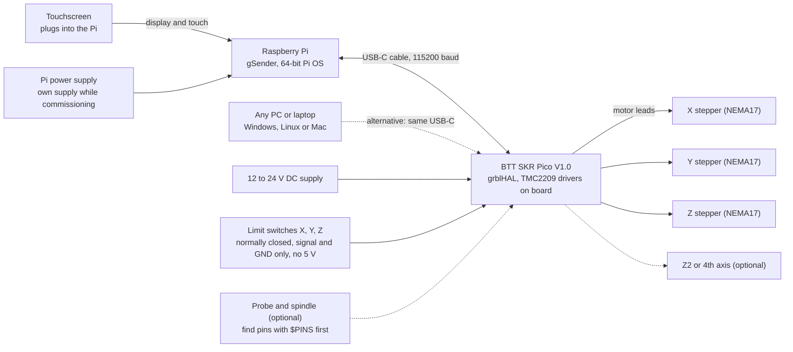

# grblHAL on BTT SKR Pico: CNC mill controller setup guide

*Written 26 Nov 2026.* A step-by-step guide for people who know Marlin/Klipper printers, covering an SKR Pico V1.0 running grblHAL with a Raspberry Pi sender.

## Before you start: safety and words you will meet

This project mixes electronics, power supplies and a machine with a spinning cutter. If you are under 18, do it with an adult or teacher who can supervise. These are general workshop rules, not figures from the sources below.

- Wire and change things with the power **off** and the supply unplugged, then check before switching on.
- Keep fingers, hair, sleeves and jewellery away from the cutter. Wear safety glasses once you cut anything.
- Fit an emergency stop that cuts power to the motors and spindle, and know where it is before every run.
- Have an adult handle anything connected to mains power.
- Test with the spindle off and the tool well clear of the work first.

| Word | What it means here |
| --- | --- |
| Firmware | The program stored permanently inside the control board. Here, grblHAL |
| G-code | The text file of movement commands (like `G1 X10 F200`, "move to X=10") that a CNC runs |
| Sender | The program on the Pi that shows the screen and streams G-code to the board (gSender or bCNC) |
| Stepper motor | A motor that turns in small, exact steps instead of spinning freely, as in your 3D printer |
| Driver (TMC2209) | The chip that powers a stepper. On this board the drivers are built in |
| Microstepping | Splitting each motor step into smaller ones (1/16 here) for smoother, quieter movement |
| Steps per mm | How many pulses the board sends to move an axis 1 mm; you calculate it from your leadscrew or belt |
| Limit switch | A switch the axis presses at the end of its travel, so the board knows where the end is |
| Homing | The machine driving each axis to its limit switch to learn where it is |
| Flashing | Copying firmware onto the board |
| Terminal / console | A text window where you type a command and the board answers |
| `$` commands | grblHAL's own commands, like `$$` (show settings) and `$H` (home) |

## Architecture and parts

The Pi runs the sender (UI and G-code streaming); the SKR Pico runs grblHAL (step generation, limits, spindle) and its on-board TMC2209 drivers move the NEMA17s. They talk over USB serial.

**The sender does not have to run on a Pi.** gSender or bCNC can run on any existing PC or laptop, whether Windows, Linux or Mac, connected to the SKR Pico by the same USB-C cable (gSender publishes Windows, Mac and Linux builds as well as a Pi build, per [Sienci](https://github.com/Sienci-Labs/gsender)). This guide uses a Raspberry Pi with a touchscreen so the machine is self-contained and needs no separate computer.

1. Touchscreen → Raspberry Pi (Raspberry Pi OS, 64-bit) running gSender or bCNC.
2. Pi → SKR Pico over USB-C (the Pico enumerates as a serial device; grblHAL uses 115200 baud, 8N1 on a terminal).
3. SKR Pico → on-board TMC2209 drivers (UART mode, X, Y, Z1, Z2, E) → NEMA17 steppers.
4. Limit switches, probe and spindle control wire to the Pico's inputs and outputs.



The Pi and its touchscreen are one unit; a single USB-C cable carries all G-code and status between the Pi and the Pico. Steppers, limit switches and power wire straight to the Pico; dashed lines are optional or alternatives. Pin names are deliberately not shown: confirm them on your own board with `$PINS` and [BTT's pinout PDF](https://github.com/bigtreetech/SKR-Pico/blob/3fa005258baeb2ce4d6e629921c4474612d13d29/Hardware/BTT%20SKR%20Pico%20V1.0-PIN.pdf).

| Part | Notes |
| --- | --- |
| BTT SKR Pico V1.0 | RP2040, 12 to 24 V DC input, 3.3 V logic, TMC2209 drivers soldered on (a dead driver means replacing the board) |
| NEMA17 steppers | Match current to the motor rating; TMC2209 tops out at 2 A RMS per the datasheet and BTT advises a fan above 0.8 A |
| Raspberry Pi 4 or better, 64-bit OS | gSender's Pi build is 64-bit only; a Pi 3B+ is reported to work with the visualizer off |
| Touchscreen | Larger is better: forum reports say small screens struggle with sender layouts |
| 12 to 24 V DC PSU | Size it for all motors plus margin; one grblHAL SKR Pico build guide recommends 150 W minimum for a foam cutter |
| Limit switches (NC), probe, spindle | Wiring covered in step 4 |

**Power supply tip: reuse an old laptop or docking-station charger.** These usually output around 19 V DC, which sits inside the SKR Pico's 12 to 24 V DC input range ([BTT wiki](https://global.bttwiki.com/SKR%20Pico.html)) and within the 5.5 to 28 V motor-supply range quoted for TMC2209 driver modules ([Fysetc](https://fysetc.github.io/Silent2209)). A used 65 to 90 W unit is a cheap way to power the board and steppers. The checks below are my engineering notes, not from the sources:

- **Read the label.** You need DC output (not AC), the voltage, and the amps. Volts × amps = watts. Add up your motor currents with a margin; the foam-cutter build guide I read recommends at least 150 W for its machine ([RC Keith](https://rckeith.co.uk/electronics-build-guide-btt-skr-pico/)), so a small charger suits only modest motor currents. Test before trusting it.
- **Keep it at or under 24 V.** 19 to 20 V is fine. I could not confirm the board's tolerance above 24 V, so do not use higher-voltage chargers.
- **Check polarity with a multimeter** before wiring. Most barrel plugs are centre-positive, but not all. Use a barrel-jack-to-screw-terminal adapter rather than hacking mains-side wiring, and have an adult supervise.
- **Branded chargers can refuse unknown loads.** Some laptop chargers have an extra ID wire and cut power or limit output without it. If the output is dead or low, try another charger.
- **USB-C laptop chargers are not a drop-in.** They negotiate their voltage and need a trigger module to deliver a fixed one.
- **Fit a fuse and the E-stop on the DC side**, as in step 4.

## Read first: known SKR Pico risks

These come from the grblHAL issue tracker and BTT's wiki. None is a reason to avoid the board, but each can damage hardware or waste an evening.

- **Start-up current.** An RP2040 issue reports high current at power-up: the board's Vref pin is unconnected, so the TMC2209 defaults to about 73% of maximum current until grblHAL sets it over UART. One user measured a peak near 200 mA fading to about 35 mA idle with `$1=25` and `$37=0`. The thread does not say which build, if any, fixed it, so confirm behaviour on your own board and PSU ([issue 74](https://github.com/grblHAL/RP2040/issues/74)).
- **Driver UART addresses.** The standard SKR Pico build maps X=0, Y=2, Z=1, A=3. A pull request notes that the Hotwire variant fell through to a generic map with Y and Z swapped ([PR 204](https://github.com/grblHAL/RP2040/pull/204)). Use the standard `BTT SKR Pico` board in the Web Builder, not the Hotwire variant.
- **Sensorless homing excludes external switches.** BTT's wiki warns that with sensorless homing enabled, external endstops cannot be used ([BTT wiki](https://global.bttwiki.com/SKR%20Pico.html)). For a mill, my recommendation is physical switches: they are repeatable, and StallGuard needs per-axis tuning.
- **No spare drivers.** The TMC2209s are soldered on, so a failed driver means a new board.
- **Set current before you enable motors.** If the current setting reads 0, a build guide warns full current can reach the motors and overheat them ([RC Keith build guide](https://rckeith.co.uk/electronics-build-guide-btt-skr-pico/)).
- **Pi power.** BTT advertises a 5 V output for an external Pi ([BTT release post](https://bigtree-tech.com/blogs/news/new-release-bigtreetech-skr-pico-v1-0-control-board)), but its wiki does not say whether powering the Pi from the board and via USB together is safe. I could not verify this, so read BTT's pinout PDF before connecting both.

## Step 0: Build the Raspberry Pi image and first boot

You write the Pi's operating system (OS) onto a memory card from another computer, using Raspberry Pi's free Imager tool. For the desktop version of Raspberry Pi OS, Raspberry Pi recommends a card of at least 32 GB ([Raspberry Pi docs](https://www.raspberrypi.com/documentation/computers/getting-started.html)). gSender supports 64-bit only on the Pi, so choose a 64-bit OS ([Sienci](https://resources.sienci.com/view/gdocs/)).

**What you need:** a Pi (4 or better; a 3B+ is reported to run gSender slowly), a 32 GB or larger microSD card and reader, the Pi's power supply, your touchscreen, a USB keyboard and mouse for setup, and another computer with internet.

**A. Write the image**

1. On the other computer, install Raspberry Pi Imager from [raspberrypi.com/software](https://www.raspberrypi.com/software/) and put the microSD card in the reader.
2. Imager walks you through a wizard: pick your Pi model, choose the OS, pick the storage device, configure the system, then write ([Raspberry Pi news](https://www.raspberrypi.com/news/a-new-raspberry-pi-imager/)).
3. For the OS choose **Raspberry Pi OS (64-bit)**, the full desktop version, which the Raspberry Pi kiosk tutorial also uses ([tutorial](https://www.raspberrypi.com/tutorials/how-to-use-a-raspberry-pi-in-kiosk-mode/)).
4. Choose the SD card as storage. Double-check it is the card, because writing erases the drive you pick.
5. On the customise page you can preset a hostname, time zone and keyboard layout, a username and password, Wi-Fi details and SSH ([Imager docs](https://www.raspberrypi.com/documentation/computers/imager.html)). Pick your own username and a password you will remember. Do not keep a default login (Sienci warns the old default user is `pi` and to change the password).
6. Leave SSH off unless you want remote logins; it is disabled by default ([Remote access docs](https://www.raspberrypi.com/documentation/computers/remote-access.html)).
7. If you set a hostname and later cannot change it, a forum report says leaving the hostname blank in Imager avoids it ([forum thread](https://forums.raspberrypi.com/viewtopic.php?t=394644)). That is one user's report; try without it if you hit the problem.
8. Write the image, wait for it to verify, then eject the card.

**B. First boot**

1. Put the card in the Pi, connect keyboard, mouse and screen, then plug in power. The first boot takes a few minutes.
2. Finish the welcome screens and connect to Wi-Fi or Ethernet.
3. Open a terminal and run `sudo apt update` then `sudo apt full-upgrade`, then reboot. (Standard Debian/Raspberry Pi OS update commands.)
4. Check the OS is 64-bit: run `uname -m`; `aarch64` means 64-bit. Sienci also suggests `cat /etc/os-release` to check your OS.

**C. Make it work on a small touchscreen**

Sienci says the interface needs a screen resolution of at least 1280 × 1024. If your screen is smaller, open the Pi menu → Preferences → Screen Configuration, and set the display's resolution there ([Sienci](https://resources.sienci.com/view/gdocs/)). Screens smaller than this may clip buttons.

**D. Install gSender**

1. On the Pi, open the [gSender releases page](https://github.com/Sienci-Labs/gsender/releases) and download the file with **Pi-64Bit** in its name. Sienci provides both `.AppImage` and `.deb` files; the `.deb` installs like an app.
2. Install it from the terminal: `sudo apt install ./<downloaded-file>.deb` (replace the name with your file; run it from the folder it downloaded to, usually Downloads).
3. Let your user read the USB serial port: `sudo usermod -a -G dialout <your-username>`, then restart the Pi ([Sienci](https://resources.sienci.com/view/gdocs/)).
4. If you use the AppImage instead, right-click it, open Permissions and tick executable before running it.
5. If the 3D preview is blank, Sienci suggests checking WebGL support and enabling hardware acceleration in Chromium. gSender keeps its logs in `~/.config/gSender/logs`.

Sienci says the Pi install is the least documented option and expects some Linux familiarity, so an adult or experienced friend is useful here. Keep a spare, labelled SD card with a working image once it works: it makes recovery a copy job.

## Step 1: Build and flash grblHAL

**In plain English:** firmware is the program that lives inside the board. grblHAL is the one we want, and the Web Builder is a website that assembles a copy tailored to your exact board. "Flashing" is copying that file onto the board, a bit like installing an app on a phone, except the board shows up as a USB drive and you drag the file onto it.

grblHAL is compiled per board. The Web Builder does this in 10 to 30 seconds and returns a `.uf2` for RP2040 ([grblHAL docs](https://petervanderwalt.github.io/grblhal_docs/Getting-Started/firmware-flashing)).

1. Open the grblHAL Web Builder and choose driver **RP2040**, board **BTT SKR Pico**. Leave the Hotwire variant alone.
2. Under motor/driver options, look for Trinamic (TMC2209, UART). The docs page I read does not list this option, so treat it as something to confirm: after flashing, `$$` must show `$140`–`$143` (current) and `$150`–`$153` (microsteps). If they are absent, rebuild with Trinamic enabled.
3. Add a spindle option only if you need it (PWM spindle is the default if none is set).
4. Generate and download the `.uf2`.
5. Enter the bootloader. The grblHAL docs say hold BOOTSEL while plugging in USB. BTT's wiki instead describes bridging the **Boot** pins with a jumper and pressing **Reset**. Use the jumper method on this board, then remove the jumper afterwards.
6. A drive appears (named RPI-RP2). Drag the `.uf2` onto it; the board reboots into grblHAL.

If you are updating existing firmware, save the output of `$$` first; updates can reset settings.

## Step 2: Connect, verify and reset

**In plain English:** a terminal is a text chat with the board. You type a command that starts with `$`, it types back. `$I` means "who are you?" and `$$` means "list all your settings". If both answer, the firmware is alive and the USB cable works.

Do this on the bench with the 12 to 24 V DC supply on and motors **disconnected**. Powering the board from the motor supply, not USB alone, is the normal configuration.

1. Connect USB-C to a PC. Open a serial terminal at 115200 baud, 8N1 (or use gSender's console).
2. Send `$I`. You should see the grblHAL version and a `[BOARD:...]` line naming the SKR Pico.
3. Send `$$` to list settings. Check that the current and microstep settings exist (step 1, item 2).
4. If you see odd values from a previous firmware, send `$RST=$` to restore defaults. Confirm the board still responds, then power-cycle it.
5. Send `$PINS` to print the live pin status. Keep this output: you will use it in step 4 instead of trusting a pinout diagram.
6. Useful: `$$=22` describes setting 22, and `$ESG` lists all settings with descriptions ([Sienci command list](https://sienci.zendesk.com/hc/en-us/articles/36094043206036-grbl-grblHAL-Useful-Commands)).

If the board does not answer, send Ctrl+X (soft reset) and recheck port and baud rate.

## Step 3: Motors, current and motion settings

**In plain English:** a stepper moves in tiny fixed steps. The driver decides how hard to push (current) and how finely to divide each step (microsteps). Too little current and the motor skips steps and loses its place; too much and the motor and driver get hot. "Steps per mm" is how many pulses move the axis exactly 1 mm, so the board knows that `G1 X10` means 10 mm. Change one setting at a time, test it, then move on, as you would tuning a 3D printer.

In grblHAL the Marlin `M906` and `M92` jobs are settings: send `$140=800` and press Enter, as in a terminal. Settings are only applied once the line is submitted ([RC Keith build guide](https://rckeith.co.uk/electronics-build-guide-btt-skr-pico/)).

| Setting | What it does | Starting point |
| --- | --- | --- |
| `$140`–`$143` | Driver current, mA, axes X, Y, Z, A | Default 500. Raise gradually; the motor should stay warm, not too hot to touch. Never leave at 0. |
| `$150`–`$153` | Microsteps | 16 is the default in the build guide I read |
| `$100`–`$103` | Steps per mm | Calculate below, then calibrate |
| `$110`–`$113` | Max rate, mm/min | Start low; a printed frame is less rigid than a metal mill |
| `$120`–`$123` | Acceleration, mm/s² | Start low, raise until you hear or see lost steps |
| `$3` | Direction invert mask (X=1, Y=2, Z=4) | Set so jogging +X moves the tool the right way |
| `$4` | Stepper enable invert mask | Toggle if motors do not energise |
| `$1` | Step idle delay, ms; 255 keeps motors always on | See the start-up current note |
| `$22` | Homing cycle | Keep at 0 until directions are verified (step 5) |

`$338` is the Trinamic driver enable mask (X=1, Y=2, Z=4); `$14x` and `$15x` only work through the Trinamic plugin ([grblHAL motor plugins](https://github.com/grblHAL/Plugins_motor/blob/master/README.md)). On an early SKR Pico map, the reporter had to send `$338=15` to enable the drivers, until a board-map change removed the need; see the SKR Pico board map thread ([issue 42](https://github.com/grblHAL/RP2040/issues/42)).

**Steps per mm for a leadscrew** (a standard calculation, not from a source above):

```latex
\text{steps/mm} = \frac{\text{full steps per rev} \times \text{microsteps}}{\text{lead (mm per rev)}}
```

Example: 200 × 16 ÷ 8 mm lead = 400 steps/mm. For belts it is 200 × microsteps ÷ (pitch × tooth count).

**Verify direction and distance, motors on the machine, clear travel:**

1. With `$22=0`, jog a small step: `$J=G91 G21 X1 F100`. Confirm the axis moves 1 mm in the expected direction.
2. If an axis moves the wrong way, flip its bit in `$3`.
3. Jog 10 mm against a dial indicator or calipers. New `$100` = old value × commanded ÷ measured.

Start-up current workaround from the tracker: `$1=25` with `$37=0` reduced the power-up spike for one user, at the cost of rougher jogging because the motors energise at the start of each move ([issue 74](https://github.com/grblHAL/RP2040/issues/74)). For a mill, holding position matters; weigh that yourself.

## Step 4: Limit switches, probe and spindle

**In plain English:** a limit switch is a button the axis presses at the end of its travel. Wiring it as normally closed (NC) means the circuit is complete until the switch is pressed, so a snapped wire looks like a pressed switch and stops the machine instead of letting it crash. The probe is a second switch used to find the top of the work. The spindle output turns the cutting motor on and sets its speed.

Pin assignments are fixed at compile time by the board map file, and I could not open the SKR Pico map directly (GitHub blocks automated fetches). So **do not copy pins from this guide: read them from your own board**.

1. Send `$PINS` (see step 2) and note which inputs and outputs your build exposes.
2. Check [BTT's pinout PDF](https://github.com/bigtreetech/SKR-Pico/blob/3fa005258baeb2ce4d6e629921c4474612d13d29/Hardware/BTT%20SKR%20Pico%20V1.0-PIN.pdf) (`BTT SKR Pico V1.0-PIN.pdf`, also referenced on the [BTT wiki](https://global.bttwiki.com/SKR%20Pico.html)) for connector names.
3. Wire one input at a time and watch it in the sender or with `?` status reports.

What the sources do confirm:

- **Limit switches.** One build guide wires each as NC between signal and ground on the socket, with no external pull-up and **no 5 V**, using shielded cable grounded at the controller end ([RC Keith](https://rckeith.co.uk/electronics-build-guide-btt-skr-pico/)). That guide is a foam cutter; the principle (NC, ground and signal only) holds for a mill, and `$5` inverts limit polarity if needed.
- **Fourth driver.** GPIO 13–15 serve the 4th Trinamic driver, so control inputs on those pins are lost when the 4th axis is used ([issue 42](https://github.com/grblHAL/RP2040/issues/42)). A single ganged or auto-squared axis (for example dual Z) is selected in the Web Builder's axis dropdown ([discussion 572](https://github.com/grblHAL/core/discussions/572)).
- **Probe.** BTT lists a proximity-switch input with a PNP/NPN jumper; check the PDF for pin and polarity, and set `$6` to match.
- **Spindle.** BTT lists a dedicated laser port and 3 PWM fan ports ([BTT release post](https://bigtree-tech.com/blogs/news/new-release-bigtreetech-skr-pico-v1-0-control-board)). I could not confirm which is the grblHAL spindle PWM, so find it with `$PINS` before wiring a spindle or VFD.
- **Fan.** One guide powers the cooling fan directly from 12 to 24 V DC, not the FAN sockets.

Until the machine is homed and limits tested, keep spindle power off and use a hardware E-stop in the supply line, not only software reset.

## Step 5: Homing and soft limits

**In plain English:** homing is the machine driving each axis to its limit switch to learn where it is, like touching the wall in a dark room. After that, every position is measured from those switches. Do it slowly the first time and keep a hand near the E-stop.

1. Confirm manual jogging directions (step 3) and that each limit switch changes state in the status report when pressed by hand.
2. Set travel: `$130`–`$132` (max travel per axis, mm) to the real stroke.
3. Set homing direction with `$23` (invert mask) so each axis moves toward its switch, then enable homing with `$22` (see the [settings reference](https://petervanderwalt.github.io/grblhal_docs/Reference/complete-settings-reference); the foam-cutter guide's value of 9 is specific to its machine).
4. Run `$H` slowly first: low `$25` (feed) and `$26`/`$27` debounce and pull-off per your frame. One guide warns an axis driven the wrong way into a hard stop can ruin its couplings ([RC Keith](https://rckeith.co.uk/electronics-build-guide-btt-skr-pico/)).
5. When homing is repeatable, enable soft limits (`$20=1`) and hard limits (`$21=1`) if you want switch-triggered alarms.

If an alarm triggers, `$X` unlocks it after you have moved clear. `$EAG` lists alarm descriptions ([Sienci command list](https://sienci.zendesk.com/hc/en-us/articles/36094043206036-grbl-grblHAL-Useful-Commands)).

## Step 6: Raspberry Pi, touchscreen and sender

**Pick gSender first.** It has first-class grblHAL support and a published 64-bit Pi `.deb`, while the evidence for bCNC on this stack is one forum post. That is my judgement from the sources, not a benchmark.

| | gSender | bCNC |
| --- | --- | --- |
| grblHAL support | Official; 1.6.0 (April 2026) added compatibility with newer grblHAL cores ([Sienci](https://sienci.com/2026/04/16/gsender-1-6-0-release/)) | Reported working on a Pi 3B+ with grblHAL (one user, 2021) ([OpenBuilds forum](https://openbuilds.com/posts/111276/)) |
| Pi install | 64-bit `.deb` from the [gSender releases](https://github.com/Sienci-Labs/gsender/releases); needs a desktop session, not headless ([README](https://github.com/Sienci-Labs/gsender)) | Python app, installed per the [bCNC wiki](https://github.com/vlachoudis/bCNC) (I did not verify the steps) |
| Known issues | Pi OS 32/64-bit churn; Ubuntu 24.04 blocks the Electron sandbox by default ([megathread](https://forum.sienci.com/t/raspberry-pi-install-and-supported-versions-megathread/25617?page=5)); slow visualizer on a Pi 3B+ ([forum](https://community.carbide3d.com/t/gsender-from-sienci-labs-cncjs-based-sender/35937)) | Untested by me on touchscreens; one forum user found senders cramped on a small Pi screen |

**Setup:**

1. Complete Step 0 (Pi image, first boot and gSender install), then connect the touchscreen.
2. Update the OS, then install the gSender ARM64 `.deb` with `sudo apt install ./<file>.deb`.
3. Plug the SKR Pico into the Pi by USB. If the serial port is refused, add your user to the `dialout` group (general Linux practice; log out and in afterwards).
4. In gSender, choose firmware **grblHAL**, select the Pico's serial port and connect at 115200 baud. Then check the firmware tool shows the settings from step 3.
5. Enable an on-screen keyboard for MDI and file entry; touchscreen layouts without one are a common complaint.
6. Do a dry run with the spindle off and Z raised: check mode with `$C`, then run a small air-cut file.

Power the Pi from its own supply while you commission, until you have read BTT's pinout for the board's 5 V output (see the risks section). The SKR Pico has no network hardware, so grblHAL's WebUI and Ethernet options do not apply.

## Troubleshooting

| Symptom | Likely cause | Check |
| --- | --- | --- |
| No `$I` response | Wrong port, baud or bootloader still active | 115200 8N1; Ctrl+X; remove the Boot jumper and press Reset |
| No `$140` or `$150` in `$$` | Trinamic support not built in | Rebuild in the Web Builder with the Trinamic option |
| Motors do not hold or move | Enable polarity | Toggle `$4`; confirm the motor supply is on |
| Y and Z swapped on tuning/StallGuard displays | UART address map | Use the standard SKR Pico board, not Hotwire ([PR 204](https://github.com/grblHAL/RP2040/pull/204)) |
| Motors hot at idle | Current too high, or `$1=255` with high `$14x` | Lower `$140`–`$143`; fan on the driver heatsink above 0.8 A ([BTT wiki](https://global.bttwiki.com/SKR%20Pico.html)) |
| Power-up current spike | Driver defaults before UART setup | Test `$1=25`, `$37=0` ([issue 74](https://github.com/grblHAL/RP2040/issues/74)); check PSU headroom |
| Axis homes away from the switch | Homing direction | Adjust `$23`; abort with reset or E-stop |
| False limit alarms | Noise on switch wires | Shielded cable, shield grounded at the controller only |
| gSender will not start on the Pi | 32-bit OS or sandbox restrictions | Use 64-bit Pi OS; see the [Sienci megathread](https://forum.sienci.com/t/raspberry-pi-install-and-supported-versions-megathread/25617?page=5) |

## References and other supporting documentation

Every source used to put this guide together is listed here. Pages marked (full) were opened and read in full; the rest were read as search excerpts, so check them before relying on a detail. Compiled in November 2026; link contents may have changed since.

### Hardware: BIGTREETECH SKR Pico

- [BTT SKR Pico wiki](https://global.bttwiki.com/SKR%20Pico.html) (full): board features, input voltage, sensorless-homing limits.
- [BTT SKR Pico V1.0 pinout PDF](https://github.com/bigtreetech/SKR-Pico/blob/3fa005258baeb2ce4d6e629921c4474612d13d29/Hardware/BTT%20SKR%20Pico%20V1.0-PIN.pdf) (commit 3fa0052): connector and pin names. Copyright BIGTREETECH; linked, not copied.
- [bigtreetech/SKR-Pico repository](https://github.com/bigtreetech/SKR-Pico): manuals, schematics and board drawings.
- [BTT release post](https://bigtree-tech.com/blogs/news/new-release-bigtreetech-skr-pico-v1-0-control-board): launch overview, including the 5 V output.
- [Fysetc TMC2209 notes](https://fysetc.github.io/Silent2209): motor-supply voltage range quoted for TMC2209 driver modules.

### Firmware: grblHAL

- [grblHAL project](https://github.com/grblHAL) and the [RP2040 driver](https://www.github.com/grblHAL/RP2040) (full): the firmware and the driver this board uses.
- RP2040 driver known issues: [issue 42](https://github.com/grblHAL/RP2040/issues/42) (full, fourth-driver pins), [issue 74](https://github.com/grblHAL/RP2040/issues/74) (full, start-up current) and [PR 204](https://github.com/grblHAL/RP2040/pull/204) (TMC UART address map).
- [grblHAL core discussion 572](https://github.com/grblHAL/core/discussions/572).
- [grblHAL motor plugins README](https://github.com/grblHAL/Plugins_motor/blob/master/README.md): Trinamic driver support.
- [Firmware flashing docs](https://petervanderwalt.github.io/grblhal_docs/Getting-Started/firmware-flashing) (full) and [settings reference](https://petervanderwalt.github.io/grblhal_docs/Reference/complete-settings-reference): community-hosted mirror of the grblHAL documentation, not the official wiki.
- [Sienci grbl/grblHAL useful commands](https://sienci.zendesk.com/hc/en-us/articles/36094043206036-grbl-grblHAL-Useful-Commands): `$$=n`, `$ESG`, `$EAG`, `$X`.

### Worked example

- [RC Keith: SKR Pico grblHAL build guide](https://rckeith.co.uk/electronics-build-guide-btt-skr-pico/) (full): a foam cutter, so its values are a reference for the process, not for a mill.

### G-code senders

- gSender: [repository and README](https://github.com/Sienci-Labs/gsender), [releases](https://github.com/Sienci-Labs/gsender/releases), [1.6.0 release notes](https://sienci.com/2026/04/16/gsender-1-6-0-release/), [Sienci Raspberry Pi megathread](https://forum.sienci.com/t/raspberry-pi-install-and-supported-versions-megathread/25617?page=5), [Sienci documentation](https://resources.sienci.com/view/gdocs/) and a [Carbide 3D forum thread](https://community.carbide3d.com/t/gsender-from-sienci-labs-cncjs-based-sender/35937) on visualiser performance.
- bCNC: [repository](https://github.com/vlachoudis/bCNC) and one [OpenBuilds forum post](https://openbuilds.com/posts/111276/) reporting it running with grblHAL on a Pi 3B+ (2021, a single user).

### Raspberry Pi

- [Getting started](https://www.raspberrypi.com/documentation/computers/getting-started.html), [Imager](https://www.raspberrypi.com/documentation/computers/imager.html) and [remote access](https://www.raspberrypi.com/documentation/computers/remote-access.html) documentation.
- [Raspberry Pi Imager download](https://www.raspberrypi.com/software/), [Imager announcement](https://www.raspberrypi.com/news/a-new-raspberry-pi-imager/) and the [kiosk-mode tutorial](https://www.raspberrypi.com/tutorials/how-to-use-a-raspberry-pi-in-kiosk-mode/).
- [Raspberry Pi forum thread on hostnames in Imager](https://forums.raspberrypi.com/viewtopic.php?t=394644) (one user's report).

### Licences

- [Creative Commons CC BY-SA 4.0](https://creativecommons.org/licenses/by-sa/4.0/): the licence for this guide. My automated fetch of that site was refused, so the repository's `LICENSE` text came from the [choosealicense.com](https://choosealicense.com/licenses/cc-by-sa-4.0/) copy of it. Compare it with the official text.

### Not verified: check before relying on them

- The SKR Pico board map's exact pins for limits, probe and spindle PWM. Use `$PINS` and BTT's pinout PDF.
- Whether the current Web Builder offers a Trinamic option for this board. The docs page did not mention it; settings `$140` and up are evidenced by the build guide and issue 42.
- Whether powering the Pi from the board's 5 V and USB together is safe.
- bCNC install steps on a current Pi OS; there is only the one 2021 report above.
- The `$PINS`, `$C`, `$X` and `$H` behaviour comes from community-hosted docs and standard Grbl convention. Confirm with `$$=n` and `$ESG` on your firmware build.
- The licences of the RP2040 driver and bCNC, and the grblHAL core licence (seen only on a mirror). Read each upstream licence file before reusing its code.
- Current limit and safety-engineering choices (E-stop, conservative speeds, 0.5 A start) and the power-supply checks are my recommendations, not vendor figures.
