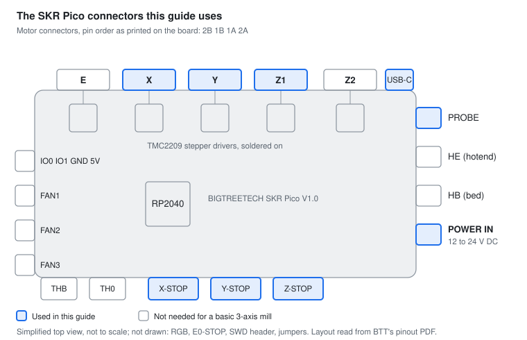
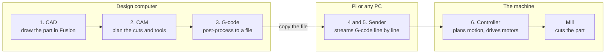
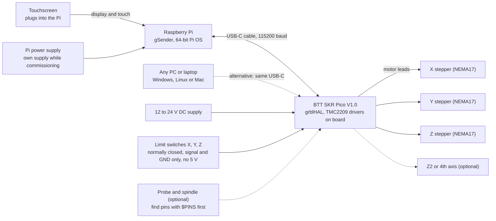
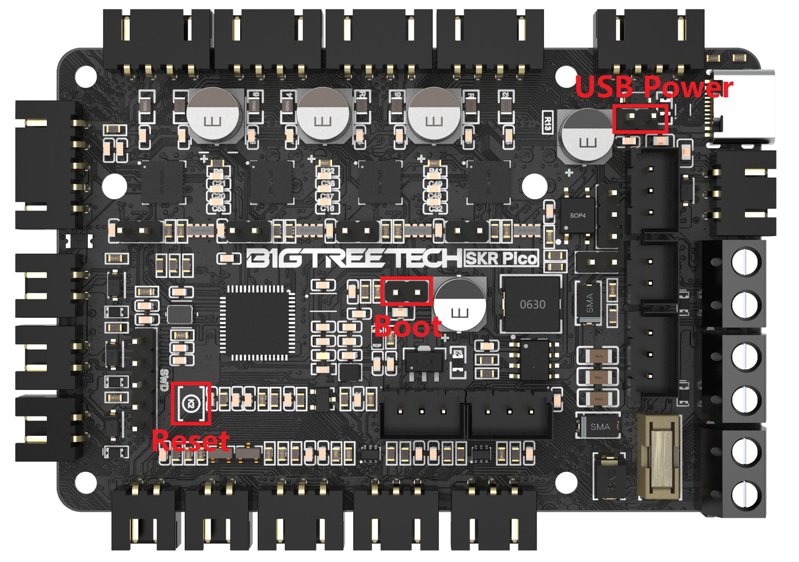
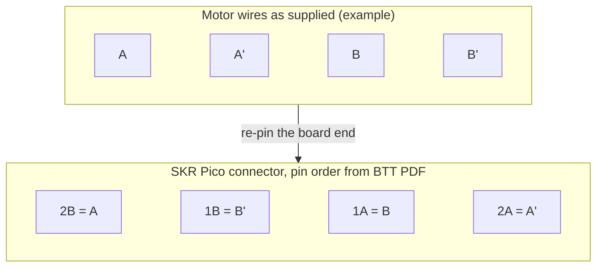
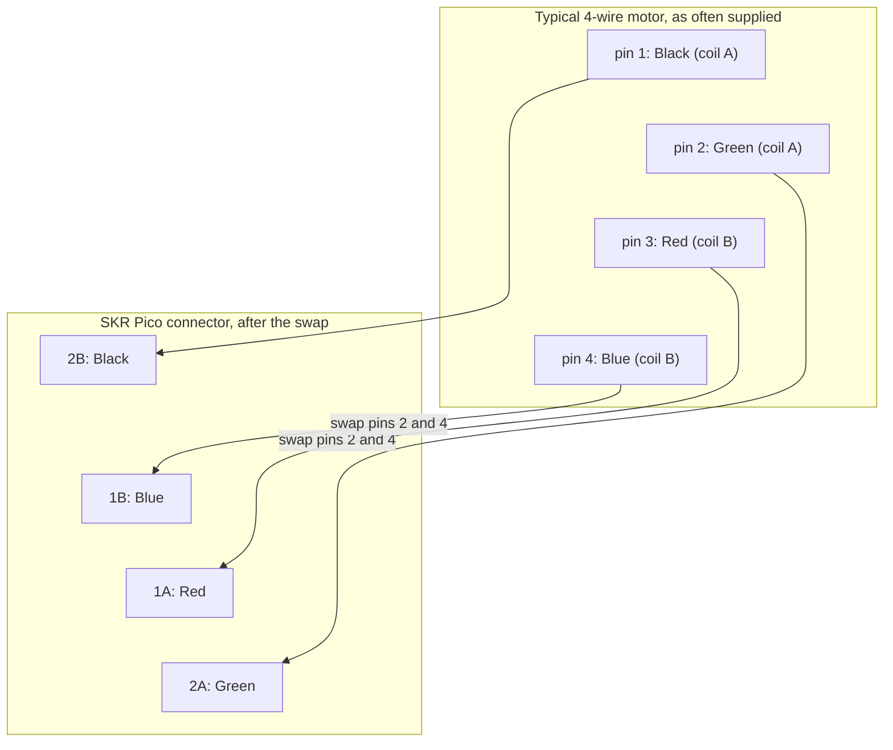
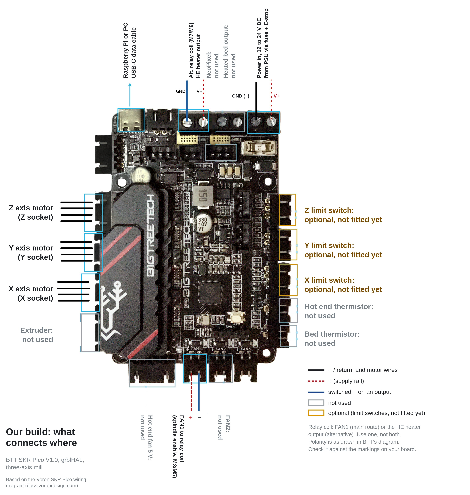
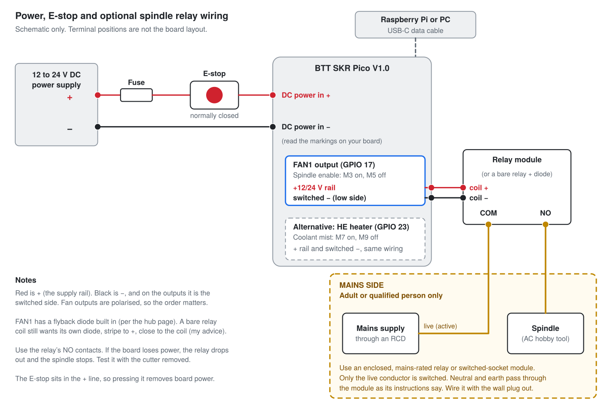

# Simple CNC mill controller setup guide
(running grblHAL on a BTT SKR Pico)

Nov 27, 2026 · Russell Brett



A step-by-step guide for people who are familiar with open source 3D printers, and may well be interested in moving from additive manufacturing (3D printing) to subtractive manufacturing - milling. This guide covers re-purposing a cheap 3D printer controller board - an SKR Pico V1.0 running grblHAL firmware, and pairing it with a Raspberry Pi for sending the Gcode. See the github repository at <https://github.com/rbrett/3D-Printed-Mill-Driver> for updated copies of this manual, and a 3D printed milling machine design that has proven successful for engraving, and very light machining of aluminium.

**Contents**

- [From drawing to cut part: how the pieces fit](#from-drawing-to-cut-part-how-the-pieces-fit)
- [Before you start: safety and words you will meet](#before-you-start-safety-and-words-you-will-meet)
- [What you will need](#what-you-will-need)
- [Architecture and parts](#architecture-and-parts)
- [Read first: known SKR Pico risks](#read-first-known-skr-pico-risks)
- [Step 1: Build and flash grblHAL](#step-1-build-and-flash-grblhal)
- [Open a serial terminal to type commands to the board](#open-a-serial-terminal-to-type-commands-to-the-board)
- [Step 2: Connect, verify and reset](#step-2-connect-verify-and-reset)
- [Step 3: Motors, current and motion settings](#step-3-motors-current-and-motion-settings)
  - [Work out your motor wiring first](#work-out-your-motor-wiring-first)
- [Step 4: Limit switches, probe and spindle](#step-4-limit-switches-probe-and-spindle)
- [Optional: switch the spindle on and off with a relay](#optional-switch-the-spindle-on-and-off-with-a-relay)
- [Step 5: Homing and soft limits](#step-5-homing-and-soft-limits)
- [Step 6: Raspberry Pi, touchscreen and sender](#step-6-raspberry-pi-touchscreen-and-sender)
- [Step 7: Configure Fusion to write G-code for this mill](#step-7-configure-fusion-to-write-g-code-for-this-mill)
- [Step 8: Your first cut](#step-8-your-first-cut)
- [Troubleshooting](#troubleshooting)
- [New and emerging open source CAD and CAM alternatives to Autodesk's Fusion](#new-and-emerging-open-source-cad-and-cam-alternatives-to-autodesks-fusion)
- [References and other supporting documentation](#references-and-other-supporting-documentation)

## From drawing to cut part: how the pieces fit

A CNC mill makes a part through a chain of hand-offs. Each stage hands a file or a stream to the next, so knowing which stage does which job makes faults much easier to find. This guide builds stages 4 to 6; stages 1 to 3 happen in your CAD and CAM software.



1. **CAD: draw the part.** You model the part on screen. This guide's example is Autodesk Fusion, which has a free version for personal use, aimed at hobbyists and people making under US$1,000 a year from their work ([Autodesk](https://www.autodesk.com/products/fusion-360/blog/fusion-for-personal-use-vs-autodesk-fusion/), [terms](https://www.autodesk.com/campaigns/fusion-360-personal-use-changes)). **Fusion works on Windows or macOS machines only. **For Linux users, Any CAD and CAM package that can output Grbl-style G-code follows the same process.
2. **CAM: plan the cuts.** CAD holds the shape; CAM decides how to cut it: the stock, the tools, the speeds and the tool-paths. The hobbyist version of Fusion has "limited CAM functionality" and "limited import/export file types" for the personal-use version, however the type of milling machine we are building here is "limited" compared with industrial machines, and won't present us a problem, with the main differences being speed of rapid movements, and lack of tool changes - nothing that will affect our use with these little machines.
3. **Post-process: write the G-code.** A post processor converts the toolpaths into G-code for one particular type of machine ([Autodesk](https://www.autodesk.com/products/fusion-360/blog/fusion-360-grbl-post/)). Fusion ships with generic posts and has an online library of more ([Autodesk help](https://help.autodesk.com/cloudhelp/ENU/Fusion-CAM/files/MFG-POST-PROCESSING-OVERVIEW.htm)). Choose the Grbl post, since grblHAL speaks Grbl-style G-code, and test with a simple shape first, as Autodesk advises ([Autodesk](https://www.autodesk.com/products/fusion-360/blog/?p=13395)). The result is a plain text file. Read it before you run it: check the spindle and tool-change lines match how you run the machine.
4. **Copy the G-code to the machine that runs the sender.** Move the file by USB stick, network share or any other file transfer to the Pi (or whichever computer runs gSender). If the sender runs on the same PC as Fusion, there is nothing to copy. Open the file in the sender program (gSender or bCNC).
5. **Sender: stream the file.** A common idea is that the sender converts G-code into something the firmware understands. It does not: grblHAL already reads G-code, so the sender's jobs are to feed the file to the controller one line at a time, read the replies, and give you live controls such as jog, hold and overrides. In Grbl's documented protocol the controller answers each line with ok or an error, and the sender either waits for every reply or counts characters so the controller's buffers stay full ([Grbl interface notes](https://github.com/gnea/grbl/wiki/Grbl-v1.1-Interface)). Real-time commands such as feed hold and status requests are picked out as they arrive and act immediately, not in the queue (same source). Those notes describe Grbl 1.1, and grblHAL is built from the same family but I have not checked its buffer sizes. If the stream cannot keep the planning buffer full, motion turns stop-start (same source), which is one reason the sender computer should not be struggling.
6. **Controller: turn lines into motion.** The SKR Pico running grblHAL does the time-critical work. Grbl is described as software that converts G-code into machine motion ([Autodesk](https://www.autodesk.com/products/fusion-360/blog/fusion-360-grbl-post/)). It parses each line, plans moves ahead so it can accelerate and slow down smoothly ([Grbl interface notes](https://github.com/gnea/grbl/wiki/Grbl-v1.1-Interface)), and pulses the stepper drivers, which move the NEMA 17 motors. It also handles homing, limit switches and alarms, covered in Steps 4 and 5 below.

**Where to look when something is wrong**:

- Wrong shape or size: CAD or CAM, before any G-code exists.
- A line is rejected with an error reply: the G-code or post processor, so read that line ([Grbl interface notes](https://github.com/gnea/grbl/wiki/Grbl-v1.1-Interface)).
- Jerky, stop-start motion: how the stream is feeding the controller, so check the sender computer.
- Motors do not move, or move the wrong way: the controller settings and the motor wiring, Steps 2 and 3 below.

## Before you start: safety and words you will meet

This project mixes electronics, power supplies and a machine with a spinning cutter. If you are under 18, do it with an adult or teacher who can supervise. These are general workshop rules, not figures from the sources below.

- Wire and change things with the power **off** and the supply unplugged, then check before switching on.
- Keep fingers, hair, sleeves and jewellery away from the cutter. Wear safety glasses once you cut anything.
- Fit an emergency stop that cuts power to the motors and spindle, and know where it is before every run.
- Have an adult handle anything connected to mains power.
- Test with the spindle off and the tool well clear of the work first.

| Word | What it means here |
| --- | --- |
| Firmware | The program stored permanently inside the control board. Here, grblHAL |
| G-code | The text file of movement commands (like `G1 X10 F200`, "move to X=10") that a CNC runs |
| Sender | The program on the Pi that shows the screen and streams G-code to the board (gSender or bCNC) |
| Stepper motor | A motor that turns in small, exact steps instead of spinning freely, as in your 3D printer |
| Driver (TMC2209) | The chip that powers a stepper. On this board the drivers are built in |
| Microstepping | Splitting each motor step into smaller ones (1/16 here) for smoother, quieter movement |
| Steps per mm | How many pulses the board sends to move an axis 1 mm; you calculate it from your leadscrew or belt |
| Limit switch | A switch the axis presses at the end of its travel, so the board knows where the end is |
| Homing | The machine driving each axis to its limit switch to learn where it is |
| Flashing | Copying firmware onto the board |
| Terminal / console | A text window where you type a command and the board answers |
| `$` commands | grblHAL's own commands, like `$$` (show settings) and `$H` (home) |

**More words you will meet**:

| Word | What it means here |
| --- | --- |
| PSU | Power supply unit: the box that gives the board its 12 to 24 V DC |
| E-stop | Emergency stop: a large button that cuts power at once |
| NC / NO | Normally closed / normally open: whether a switch's contacts are joined (NC) or apart (NO) when nobody is pressing it |
| PWM | Pulse-width modulation: switching an output on and off very fast. The share of time it is on sets the average power, which is how spindle speed is set |
| Spindle | The motor that spins the cutting tool |
| VFD | Variable-frequency drive: an electronic speed controller for an AC motor |
| Relay | An electrically operated switch: a small signal on its coil switches a larger load through its contacts |
| Jumper cap | A small cap that joins two pins on a header |
| Bootloader | A built-in mode of the RP2040 chip in which the board appears as a USB drive so firmware can be copied on |
| Jog | Moving an axis a small, chosen distance by command |
| MDI | Manual data input: typing one line of G-code into the sender and running it |
| Work zero (work offset) | The point on your stock that the program treats as X0 Y0 Z0. G54 is the first of the stored sets |
| Soft limits | A software check that refuses moves beyond the travel you set. They need homing first ([Grbl configuration page](https://github.com/gnea/grbl/wiki/Grbl-v1.1-Configuration)) |
| Hard limits | The limit switches themselves raising an alarm when pressed during a move |
| Homing debounce / pull-off | Debounce is a short wait so a switch signal can settle; pull-off is how far the axis backs off the switch after homing ([Grbl configuration page](https://github.com/gnea/grbl/wiki/Grbl-v1.1-Configuration)) |
| Toolpath | The route the cutter follows |
| Feeds and speeds | How fast the tool moves through the work (feed) and how fast it spins (speed) |
| Bitmask | A number made by adding values for several axes (X=1, Y=2, Z=4) so one setting can cover them all |

## What you will need

This list is a guide for the basics, but additional parts will likely be required.

**Parts**

- BTT SKR Pico V1.0 board, and a USB-C **data** cable (a charge-only cable will not work)
- 12 to 24 V DC power supply (see the power supply tip below)
- An inline fuse and holder, and a hardware emergency stop (E-stop) button (Step 2)
- NEMA17 stepper motors with their cables
- A jumper cap for the Boot pins (Step 1)
- Raspberry Pi 4 or better, a 32 GB or larger microSD card, and a touchscreen (Step 6)
- Limit switches and a probe (Steps 4 and 5; you can add these later)
- A spindle, and optionally a relay module to switch it (Step 4 and the relay section)

**Tools**

- A multimeter (Steps 2 and 3)
- Small screwdrivers and wire strippers
- A crimp tool and spare connector pins, if you need to re-pin a motor plug (Step 3)
- Calipers or a dial indicator, to check distances (Step 3)
- A second computer for building the firmware and the Pi's memory card

**Skills**

You do not need to write code. You do need to be comfortable typing short commands into a terminal window (the guide shows you how) and following a wiring diagram. Anything connected to mains power is for a suitably qualified person or electrician.

## Architecture and parts

The Pi runs the sender (UI and G-code streaming); the SKR Pico runs grblHAL (step generation, limits, spindle) and its on-board TMC2209 drivers move the NEMA17s. They talk over USB serial.

**The sender does not have to run on a Raspberry Pi.** gSender or bCNC can run on any existing PC or laptop, whether Windows, Linux or Mac, connected to the SKR Pico by the same USB-C cable (gSender publishes Windows, Mac and Linux builds as well as a Pi build, per [Sienci](https://github.com/Sienci-Labs/gsender)). This guide uses a Raspberry Pi with a touchscreen so the machine is self-contained and needs no separate computer.

1. Touchscreen → Raspberry Pi (Raspberry Pi OS, 64-bit) running gSender or bCNC.
2. Pi → SKR Pico over USB-C (the Pico enumerates as a serial device; grblHAL uses 115200 baud, 8N1 on a terminal).
3. SKR Pico → on-board TMC2209 drivers (UART mode, X, Y, Z1, Z2, E) → NEMA17 steppers.
4. Limit switches, probe and spindle control wire to the Pico's inputs and outputs.



The Pi and its touchscreen can be one unit; the author used a dedicated portable touch screen monitor via HDMI and USB for increased resolution and larger display.  A single USB-C cable carries all G-code and status between the Pi (or Sender software) and the Pico. Steppers, limit switches and power wire straight to the Pico; the dashed items are optional or alternatives.

| Part | Notes |
| --- | --- |
| BTT SKR Pico V1.0 | RP2040, 12 to 24 V DC input, 3.3 V logic, TMC2209 drivers soldered on (a dead driver means replacing the board) |
| NEMA17 steppers | Match current to the motor rating; TMC2209 tops out at 2 A RMS per the datasheet and BTT advises a fan above 0.8 A |
| Raspberry Pi 4 or better, 64-bit OS | gSender's Pi build is 64-bit only; a Pi 3B+ is reported to work with the visualizer off.  A old laptop running Linux works well too for repurposing old hardware and keeping costs down, given how expensive new hardware is right now thanks to the AI boom. |
| Touchscreen | Larger is better: forum reports say small screens struggle with sender layouts |
| 12 to 24 V DC PSU | Size it for all motors plus margin; one grblHAL SKR Pico build guide recommends 150 W minimum for a foam cutter |
| Limit switches (NC), probe, spindle | Wiring covered in step 4 |

**Power supply tip: reuse an old laptop or docking-station charger.** These usually output around 19 V DC, which sits inside the SKR Pico's 12 to 24 V DC input range ([BTT wiki](https://global.bttwiki.com/SKR%20Pico.html)) and within the 5.5 to 28 V motor-supply range quoted for TMC2209 driver modules.

A used 65 W to 120 W unit is a cheap way to power the board and steppers.

- **Read the label.** You need DC output (not AC), the voltage, and the amps. Volts × amps = watts. Add up your motor currents with a margin; the foam-cutter build guide I read recommends at least 150 W for its machine ([RC Keith](https://rckeith.co.uk/electronics-build-guide-btt-skr-pico/)), so a small charger suits only modest motor currents. Test before trusting it, and
- **Keep it at or under 24 V.** 19 to 20 V is fine. I could not confirm the board's tolerance above 24 V, so do not use higher-voltage chargers.
- **Check polarity with a multimeter** before wiring. Most barrel plugs are centre-positive, but not all. Use a barrel-jack-to-screw-terminal adapter rather than hacking mains-side wiring, and have an adult supervise.
- **Branded chargers can refuse unknown loads.** Some laptop chargers have an extra ID wire and cut power or limit output without it. If the output is dead or low, try another charger.
- **WARNING: USB-C based laptop chargers are not compatible.** They negotiate their voltage and need a trigger module to deliver a fixed one.
- **Fit a fuse and the E-stop on the DC side**, as in step 4.

## Read first: known SKR Pico risks

These come from the grblHAL issue tracker and BTT's wiki. None is a reason to avoid the board, but each can damage hardware or waste an evening.

- **Start-up current.** An RP2040 issue reports high current at power-up: the board's Vref pin is unconnected, so the TMC2209 defaults to about 73% of maximum current until grblHAL sets it over UART. One user measured a peak near 200 mA fading to about 35 mA idle with `$1=25` and `$37=0`. The thread does not say which build, if any, fixed it, so confirm behaviour on your own board and PSU ([issue 74](https://github.com/grblHAL/RP2040/issues/74)).
- **Driver UART addresses.** The standard SKR Pico build maps X=0, Y=2, Z=1, A=3. A pull request notes that the Hotwire variant fell through to a generic map with Y and Z swapped ([PR 204](https://github.com/grblHAL/RP2040/pull/204)). Use the standard `BTT SKR Pico` board in the Web Builder, not the Hotwire variant.
- **Sensorless homing excludes external switches.** BTT's wiki warns that with sensorless homing enabled, external endstops cannot be used ([BTT wiki](https://global.bttwiki.com/SKR%20Pico.html)). For a mill, my recommendation is physical switches: they are repeatable, and StallGuard needs per-axis tuning.
- **No spare drivers.** The TMC2209s are soldered on, so a failed driver means a new board. This is why it's not a good idea to plug or unplug motors whilst the board is powered.
- **Set current before you enable motors.** If the current setting reads 0, a build guide warns full current can reach the motors and overheat them ([RC Keith build guide](https://rckeith.co.uk/electronics-build-guide-btt-skr-pico/)).
- **Pi power.** BTT advertises a 5 V output for an external Pi ([BTT release post](https://bigtree-tech.com/blogs/news/new-release-bigtreetech-skr-pico-v1-0-control-board)), but its wiki does not say whether powering the Pi from the board and via USB together is safe. I could not verify this, so read BTT's pinout PDF before connecting both.

## Step 1: Build and flash grblHAL

**In plain English:** firmware is the program that lives inside the board. grblHAL is the one we want, and the Web Builder is a website that assembles a copy tailored to your exact board. "Flashing" is copying that file onto the board, a bit like installing an app on a phone, except the board shows up as a USB drive and you drag the file onto it.

grblHAL is compiled per board. The Web Builder does this in 10 to 30 seconds and returns a `.uf2` for RP2040 ([grblHAL docs](https://petervanderwalt.github.io/grblhal_docs/Getting-Started/firmware-flashing)).

If you are updating existing firmware, save the output of `$$` first; updates can reset settings. The Web Builder page gives this warning for updates from builds older than 20241208. To update later, repeat parts B and C with a freshly built file.

**A. Build the firmware in the Web Builder.** The Web Builder is one web page with no sign-in, at [svn.io-engineering.com:8443](https://svn.io-engineering.com:8443/). It calls itself "work in progress" and says the builds are verified only by people who own the boards. I read version 1.0.1 (grblHAL build 20261123) on 26 Nov 2026, so menus may have changed since.

1. Leave the three optional dropdowns at the top (Machine vendor, Machine, Variant) alone. They load vendor profiles for other machines (Sienci, Ooznest, OpenBuilds and Voron when I looked), not this board.
2. Set **Driver** to "RP2040 (Pi Pico & Pi Pico W)". The **Boards** list then fills in.
3. Set **Boards** to "BTT SKR Pico 1.0". Do not pick the "Hotwire" variant (see "Read first"). The blue **i** beside Boards lists what the build supports for this board: up to 4 axes and 4 motors, native USB, a probe input, one PWM spindle, ModBus, and no SD card, WiFi or I2C. The page itself warns that list may be incorrect.
4. On the **General** tab, set the options in the table below. Leave the other tabs (Plugins, Network/WebUI, Advanced features, 3rd party plugins, Optional inputs, I/O expansion) at their defaults for a first build. The page warns that 3rd party plugins may break the compile, so leave those unticked.
5. Click **Generate and download firmware**. The grblHAL docs say this takes about 10 to 30 seconds. The page also prints your chosen options to the browser console (press F12), a handy record of exactly what you built.
6. Save the download. (Your web browser will probably save it automatically to its default download directory). The filename should be called "firmware.uf2" unless there is already a file of that name in that directory. If so, check what your operating system renamed the new file to.

| Setting (General tab) | Choose | Why |
| --- | --- | --- |
| Connection | Native USB (default) | The Pi or PC talks to the board over its USB-C port. The other choice, (Virtual) UART, is a serial-header connection instead. |
| Number of axes | 3 | X, Y and Z. The board supports 4, but the fourth driver shares pins with control inputs (issue 42, see "Read first"). |
| X-axis, Y-axis, Z-axis | Single motor | One motor per axis. Ganged or Auto-squared is for two motors on one axis, and the board allows one such axis. |
| Probe input | Ticked (default) | Leaves the probe input available. You can leave it unused. |
| Trinamic drivers and mode | Greyed out: TMC2209, R sense 110 mΩ, UART soft address | Fixed by the board choice, so there is nothing to set. It should make the Trinamic settings (`$140` and up) available, which part D checks. |
| Spindle 1 | PWM (default) | Match your spindle hardware. On/Off suits a relay-switched spindle. The VFD entries (Huanyang and others) are for spindle drives, so read the grblHAL spindle docs before using one. |
| Spindles 2 to 4, ModBus RTU | Disabled (default) | Not needed for a basic mill. |

**B. Put the board in bootloader mode.** The RP2040 has a built-in bootloader that appears on your computer as a USB drive. On the SKR Pico you enter it with a jumper and the Reset button, as BTT's manual describes ([BTT manual](https://github.com/bigtreetech/SKR-Pico/blob/3fa005258baeb2ce4d6e629921c4474612d13d29/BTT%20SKR%20Pico%20V1.0%20Instruction%20Manual.pdf), section IV).



The red boxes mark the three parts used below: the **USB Power** jumper (top right, beside the USB-C socket), the **Boot** jumper pins (centre) and the **Reset** button (lower left). 

**WARNING:** Always disconnect the 12 to 24 V DC source from the board, before plugging in the USB Power jumper, then remove this and the boot jumper after the firmware upload process has completed, before re-connecting the external power supply.

1. Power the board. The normal way is the 12 to 24 V DC supply with the motors disconnected, as in Step 2. To flash on USB power alone, fit the board's USB power jumper first and remove it afterwards.
2. Fit a jumper cap on the two **Boot** pins.
3. Connect a USB-C data cable from the board to the PC or Pi. A charge-only cable will not work.
4. Press **Reset**. A drive named RPI-RP2 should appear in your file manager. BTT's manual spells it "RPI-PR2", which looks like a typo; the grblHAL docs give RPI-RP2.
5. If no drive appears, check the cable, check the jumper sits on the Boot pins, and press Reset again.

**C. Copy the firmware onto the board.**

1. Drag the `.uf2` file onto the RPI-RP2 drive.
2. When the copy finishes, the board reboots by itself and the drive disappears (BTT's manual). This happens very quickly. A new serial port should then appear; part D checks it.
3. Unplug USB, remove the Boot jumper (and the USB power jumper if you fitted it), then press Reset or power-cycle the board.

**D. Check it worked.** Open a terminal as described in the next section, then send `$I` and `$$`. Confirm that `$140` to `$143` (motor current) and `$150` to `$153` (microsteps) exist. If they are missing, re-check the Driver and Boards selections and build again.

## Open a serial terminal to type commands to the board

Steps 2 to 5 type commands such as `$I` and `$$` straight to the board. A sender such as gSender can do this, but any program that opens the board's USB serial port will do. A terminal is handy when you want to check the firmware before a sender is installed, or when a sender will not connect.

**Close gSender and any other sender first.** Only one program should hold the port at a time.

**Settings to use**

- **Speed 115200, 8 data bits, no parity, 1 stop bit** ([Grbl configuration page](https://github.com/gnea/grbl/wiki/Grbl-v1.1-Configuration/f7a8ef43bd2bc0dab6e7cbdd31a05668d22d3394), [grblHAL first-connection page](https://petervanderwalt.github.io/grblhal_docs/Getting-Started/first-connection)). Set flow control to None.
- **Line ending:** grblHAL accepts CR, LF or CRLF, so any Enter key setting works ([grblHAL sender notes](https://petervanderwalt.github.io/grblhal_docs/Advanced-Topics/sender-interface)).
- **Local echo off.** If every letter you type appears twice, turn local echo off.
- **Do not type at once.** Native USB boards do not reset when a program connects ([grblHAL sender notes](https://petervanderwalt.github.io/grblhal_docs/Advanced-Topics/sender-interface)), so wait a moment, then press Enter.

**What you can use on each system**

| OS | Supplied with the system | Open source, free to install | How to install |
| --- | --- | --- | --- |
| Windows | None that I could confirm. Device Manager only shows you the COM port number | [PuTTY](https://www.chiark.greenend.org.uk/~sgtatham/putty/) and [Tera Term](https://teratermproject.github.io/index-en.html) (BSD licence) | Download the installer from each project's own site |
| macOS | `screen`, included with macOS ([Adafruit](https://learn.adafruit.com/adafruit-metro-rp2350/advanced-serial-console-on-mac-and-linux)) | `tio`, `picocom` and `minicom` | Homebrew: `brew install tio` (see the Homebrew steps below) |
| Linux | `screen` is often already installed; if not, install it from your package manager ([Adafruit](https://learn.adafruit.com/adafruit-rp2040-feather-thinkink/advanced-serial-console-on-linux)) | `tio`, `picocom`, `minicom` | `sudo apt install tio` or `sudo dnf install tio` ([install list](https://linuxcommandlibrary.com/man/tio)); the same pattern works for `picocom` |

If you want the simplest choice: PuTTY on Windows, `screen` on a Mac (nothing to install), and `tio` on Linux or on a Mac with Homebrew.

### Windows

1. Install PuTTY or Tera Term.
2. Open Device Manager and expand **Ports (COM & LPT)**. Look once with the board unplugged and once with it plugged in. The new entry, often named like "USB Serial Device (COM3)", is the board ([Adafruit](https://learn.adafruit.com/welcome-to-circuitpython/advanced-serial-console-on-windows), [grblHAL first-connection page](https://petervanderwalt.github.io/grblhal_docs/Getting-Started/first-connection)).
3. **PuTTY:** choose connection type **Serial**, type the COM port into **Serial line**, set **Speed** to 115200, set **Flow control** to None, then click **Open** ([Microchip's PuTTY steps](https://onlinedocs.microchip.com/oxy/GUID-89EB0D7B-28D5-4DB5-8514-92AEE14FBED9-en-US-3/GUID-6D5F647D-41C7-4B81-8ED4-373DA08BCFDB.html)). Type a name under **Saved Sessions** and click **Save** to reuse the settings ([example](https://web.eece.maine.edu/~vweaver/classes/ece177_2026s/labs/configure_putty.pdf)).
4. **Tera Term:** in the New connection window pick **Serial** and choose the port from the list. Adjust speed under **Setup > Serial port** ([SparkFun](https://learn.sparkfun.com/tutorials/terminal-basics/tera-term-windows)).

### macOS

1. Open **Terminal** (Applications > Utilities).
2. Run `ls /dev/tty.*` with the board unplugged, then again with it plugged in. The new entry, usually named like `/dev/tty.usbmodem1101`, is the board ([Adafruit](https://learn.adafruit.com/adafruit-metro-rp2350/advanced-serial-console-on-mac-and-linux)). The number will differ on your Mac.
3. **Built-in `screen`:** run `screen /dev/tty.usbmodem1101 115200`, using your own port name. To leave, press Ctrl-A, then K; `screen` may ask you to confirm ([a user's tip on SparkFun](https://learn.sparkfun.com/tutorials/terminal-basics/discuss)). Adafruit warns that `screen` is rough around the edges and suggests `tio` if you can install it.
4. **`tio`:** after installing it with Homebrew, run `tio /dev/tty.usbmodem1101`. Its defaults are 115200, 8 data bits, no parity, 1 stop bit and no flow control ([tio README](https://github.com/FS-make-simple/tio)).

#### To easily install these open source packages on a Mac, "Homebrew" is the third-party package manager most often used. Check for it, and install it if it is missing

**Step 1. Check your Mac.** Homebrew needs macOS Sequoia (15) or newer. To see which chip you have, open the Apple menu and choose **About This Mac**.

**Step 2. Check whether Homebrew is installed.** In Terminal, run:

```
brew --version
```

If it prints a version number, Homebrew is installed and on your path. Skip to step 6.

**Step 3. If you see "command not found", look for it.** It may be installed but missing from your path. Check the default location: `ls /opt/homebrew/bin/brew` on an Apple Silicon Mac, or `ls /usr/local/bin/brew` on an Intel Mac (the default prefixes are listed on [brew.sh](https://brew.sh/)). If the file exists, go to step 5. If you get "No such file", Homebrew is not installed.

**Step 4. Install it.** Copy the command only from [brew.sh](https://brew.sh/), because old copies exist. At the time of writing, the correct command was:

```
/bin/bash -c "$(curl -fsSL https://raw.githubusercontent.com/Homebrew/install/HEAD/install.sh)"
```

The script explains what it will do and then pauses before it does it ([brew.sh](https://brew.sh/)), so read what it says. You need the Xcode Command Line Tools only to build packages from source ([Homebrew install docs](https://docs.brew.sh/Installation)); the installer will tell you if it needs them.

**Step 5. Put it on your path.** At the end the installer prints "Next steps" for your shell. Follow them: Homebrew's documentation says it will not work if you skip them. On an Apple Silicon Mac the line is `eval "$(/opt/homebrew/bin/brew shellenv)"`; add it to `~/.zprofile` as the installer instructs, then open a new Terminal window ([Homebrew install docs](https://docs.brew.sh/Installation)).

**Step 6. Confirm, then install a terminal.** Run `brew --version` again to confirm, then `brew install tio`.

### Linux

1. Run `ls /dev/ttyACM*` with the board unplugged, then again with it plugged in. The new entry, usually `/dev/ttyACM0`, is the board ([Adafruit](https://learn.adafruit.com/adafruit-rp2040-feather-thinkink/advanced-serial-console-on-linux)). A board with its own USB port normally shows as `ttyACM`, not `ttyUSB` ([overview](https://cmaven.github.io/en/etc/linux-serial-terminal-programs/)).
2. **Permission.** Run `ls -l /dev/ttyACM0` to see which group owns the port. On most systems it is `dialout`. Add yourself with `sudo usermod -a -G dialout $USER`, replacing `dialout` with the group you saw, then log out and back in or restart ([Arduino support](https://support.arduino.cc/hc/en-us/articles/360016495679-Fix-port-access-on-Linux)).
3. **`tio`:** run `tio /dev/ttyACM0`. To quit, press Ctrl-T, then Q ([Adafruit](https://learn.adafruit.com/adafruit-memento-camera-board/advanced-serial-console-on-linux)). Using the path under `/dev/serial/by-id/` gives the board a stable name and lets `tio` reconnect when you replug it ([tio README](https://github.com/FS-make-simple/tio)).
4. **`picocom`:** run `picocom -b 115200 /dev/ttyACM0`. To quit, press Ctrl-A, then Ctrl-X ([picocom man page](https://manpages.ubuntu.com/manpages/resolute/man1/picocom.1.html)).
5. **`screen`:** run `screen /dev/ttyACM0 115200`. To quit, press Ctrl-A, then K.

### What to type first

Press Enter, then type `$I` and press Enter. The board should print its version and build information. `$$` lists the settings. Steps 2 and 3 say which values to expect and what to change. Close the terminal before you open gSender.

### If nothing appears

- **No new port when you plug in:** the board may still be in bootloader mode. Remove the Boot jumper and press Reset (see Step 1 part B), then check the port list again.
- **Port busy or permission denied:** close gSender and any other terminal, unplug and replug the board, and on Linux check the `dialout` step. On some Linux systems ModemManager opens new serial ports for a while after you plug them in ([one user's account](https://downtowndougbrown.com/?p=968)); I have not checked whether it affects this board.
- **Connected but silent:** press Enter, or send `?` for a status line. A LightBurn user's SKR Pico answered only after the program turned DTR on ([LightBurn forum](https://forum.lightburnsoftware.com/t/connecting-to-grblhal-without-welcome-message/92961)), so try a different terminal if yours has no DTR setting.
- **Every letter doubled:** turn local echo off.

## Step 2: Connect, verify and reset

**In plain English:** a terminal is a text chat with the board. You type a command that starts with `$`, it types back. `$I` means "who are you?" and `$$` means "list all your settings". If both answer, the firmware is alive and the USB cable works.

Do this on the bench with the 12 to 24 V DC supply on and motors **disconnected**. Before you switch the supply on, fit the fuse and the hardware E-stop on its DC side (see the power supply tip under Architecture and parts, and Step 4). Powering the board from the motor supply, not USB alone, is the normal configuration.

### Wire the supply, fuse and E-stop first

I could not confirm how BTT labels the board's power-input terminals. Read BTT's pinout PDF (linked from the BTT wiki in the references) and match its + and − markings to the board itself before you connect anything. The wiring order below is my layout, not a BTT diagram.

1. Unplug the supply from the wall and keep everything switched off while you wire.
2. Check the supply's DC polarity with a multimeter (see the power supply tip above).
3. Wire in this order: supply **+** to the fuse, the fuse to the E-stop, the E-stop to the board's **+** power input. Wire supply **−** straight to the board's **−** power input. Use a normally closed E-stop button, so that pressing it breaks the circuit.
4. Choose the fuse rating yourself. No source I found gives a figure for this board. My rule of thumb: above the most current your motors and relay coil will draw together, and below both the supply's rated output and the wire's rating. A fuse protects the wiring from a short circuit. It does not protect the board's soldered-on drivers.
5. **Test the E-stop with the motors still disconnected.** Switch on, confirm the board is powered, press the E-stop, and confirm power goes away. Release it and confirm power returns. If pressing it ever fails to cut power, stop and fix that before going any further.
6. If you fitted the USB power jumper for flashing, remove it now. A fitted jumper can let USB power keep the board alive when the E-stop cuts the supply (my reading of the jumper's purpose, from Step 1 part B).

### Check that the board answers

1. Connect USB-C to a PC. Open a serial terminal (see the section above) at 115200 baud, 8N1 (or use gSender's console).
2. Send `$I`. You should see the grblHAL version and a `[BOARD:...]` line naming the SKR Pico.
3. Send `$$` to list settings. Check that the current and microstep settings exist (Step 1, part D).
4. If you see odd values from a previous firmware, send `$RST=$` to restore defaults. Confirm the board still responds, then power-cycle it.
5. Send `$PINS` to print the live pin status. Keep this output: you will use it in step 4 instead of trusting a pinout diagram.
6. Useful: `$$=22` describes setting 22, and `$ESG` lists all settings with descriptions ([Sienci command list](https://sienci.zendesk.com/hc/en-us/articles/36094043206036-grbl-grblHAL-Useful-Commands)).

If the board does not answer, send Ctrl+X (soft reset) and recheck port and baud rate.

## Step 3: Motors, current and motion settings

**In plain English:** a stepper moves in tiny fixed steps. The driver decides how hard to push (current) and how finely to divide each step (microsteps). Too little current and the motor skips steps and loses its place; too much and the motor and driver get hot. "Steps per mm" is how many pulses move the axis exactly 1 mm, so the board knows that `G1 X10` means 10 mm. Change one setting at a time, test it, then move on, as you would tuning a 3D printer.

### Work out your motor wiring first

**Why this step exists.** A NEMA 17 has two coils, so four wires. The driver expects both wires of one coil on one output pair and both wires of the other coil on the other pair. A Duet forum reply calls connecting stepper wires to the wrong pins the easiest way to kill a driver ([Duet forum](https://forum.duet3d.com/post/322741)), and the SKR Pico's drivers are soldered on, so a dead one means a new board. A motor whose coils are mixed up typically just vibrates and does not turn ([Duet forum](https://forum.duet3d.com/post/276271)).

**The catch on this board.** BTT's pinout labels each motor connector, in order, 2B, 1B, 1A, 2A ([BTT pinout PDF](https://github.com/bigtreetech/SKR-Pico/blob/3fa005258baeb2ce4d6e629921c4474612d13d29/Hardware/BTT%20SKR%20Pico%20V1.0-PIN.pdf)). TMC2209 outputs are named M1A and M1B for one coil and M2A and M2B for the other ([Tinkered](https://tinkered.ai/components/tmc2209-stepper-driver)). From those names, one coil sits on the two outer pins (2B and 2A) and the other on the two middle pins (1B and 1A). That is my reading of the labels, not a BTT statement, so confirm it with the tests below. Many motors and cables put each coil's wires side by side, for example black and green, then red and blue ([applied-ee](https://applied-ee.github.io/embedded/docs/motor-control/stepper-motors/stepper-types-and-wiring/)). Plugged straight in, that puts mismatched wires on each pair. This is the likely reason some imported motors needed re-pinning.



**Do not trust wire colours.** They differ between makers, and Duet forum regulars advise identifying the windings by testing instead ([Duet forum](https://forum.duet3d.com/post/286023)).

**A typical motor, and the one swap.** A common 4-wire NEMA 17 pairs black with green for one coil and red with blue for the other ([applied-ee](https://applied-ee.github.io/embedded/docs/motor-control/stepper-motors/stepper-types-and-wiring/)). If a cable runs in the order black, green, red, blue, the pairs are side by side. The diagram shows that case: swapping the wires in pins 2 and 4 (green and blue) puts black and green on the outer pins and blue and red on the middle pins, which is what the connector needs. The motor may then turn the opposite way; part C below says how to fix that. This is my own working-out from the connector labels, so test before you trust it, and note that a motor with a different pairing needs a different swap. The rule to apply is always the same: one coil outer, the other coil in the middle.



**A. Find the two coils** (motor unplugged, nothing powered):

1. **Multimeter, resistance mode.** Pick one wire and measure it against each of the other three. One reading is low (typically 1 to 10 Ω) and is its coil partner; the other two read open ([applied-ee](https://applied-ee.github.io/embedded/docs/motor-control/stepper-motors/stepper-types-and-wiring/), [SparkFun](https://learn.sparkfun.com/tutorials/big-easy-driver-hookup-guide/hardware-hookup)). The remaining two wires should also read low to each other.
2. **Label each pair with tape straight away**, for example coil A and coil B, so you do not lose track ([RatRig](https://wiki.ratrig.com/build-guides/mill-wiring)).
3. **No meter?** Join two wires with a paperclip and turn the shaft by hand. If it gets harder to turn, those two wires are one coil ([MatterHackers](https://forums.matterhackers.com/post/70?page=1)). An LED across two wires lights as you spin the shaft if they are a pair ([RepRap wiki](https://reprap.org/wiki/Stepper_wiring)).
4. **More than four wires?** A six-wire motor has a centre tap on each coil; the centre tap reads half the end-to-end resistance ([Sciencing](https://www.sciencing.com/wire-stepper-motor-4738199)). Use only the two end wires of each coil and leave the centre taps unconnected (my engineering note). Five-wire motors do not work with standard stepper electronics ([RepRap wiki](https://reprap.org/wiki/Stepper_wiring)).

**B. Re-pin the board-end connector** (board powered off and USB unplugged):

1. Put one coil's two wires on the outer pins (2B and 2A) and the other coil's two wires on the middle pins (1B and 1A).
2. Which wire of a coil goes on which of its two pins only decides the direction the motor turns, not whether it runs ([RepRap wiki](https://reprap.org/wiki/Stepper_wiring)). So you can fix direction later by swapping one coil's two wires.
3. Worked example (not your motor's colours): a cable in the order A, A', B, B' on pins 1 to 4 becomes A, B', B, A' after you swap the wires in pins 2 and 4. That puts coil A on the outer pins and coil B on the middle pins. The motor may then turn the opposite way, which part C explains how to fix.
4. To move a crimped pin, MatterHackers describes lifting the connector's black retaining tab with a small flat-head screwdriver, sliding the pin out the back, and pushing it back in with its ledge aligned to the tab ([MatterHackers](https://help.matterhackers.com/article/290-e3d-hemera-stepper-motor-wiring-correction)). That article is about a Dupont-style connector. I have not verified which housing your motor leads use, so check yours. Change the board-end connector only, and leave the motor-end plug alone, as MatterHackers advises.

**C. Check before powering up.** With the motor plugged into its connector and the board off, measure at the connector: pins 1 and 4 should read a low resistance, pins 2 and 3 should read a low resistance, and pin 1 to pin 2 should read open (my check, from the pairing rule above). Then continue with the settings below, starting at a low current.

- **Vibrates or buzzes but does not turn:** power off and re-test the pairs, because coils are mixed ([Duet forum](https://forum.duet3d.com/post/276271)).
- **Turns the wrong way:** swap the two wires of one coil ([Duet forum](https://forum.duet3d.com/post/276267)), or invert that axis in `$3` (see Verify direction below).
- **Never plug or unplug a motor while the board is powered.** Duet's forum describes it as well known and warned against ([Duet forum](https://forum.duet3d.com/post/322757)), and a V1 Engineering forum reply says the same ([V1 Engineering](https://forum.v1engineering.com/t/skr-1-3-tmc2209-issues-with-setting-vref/23810)).

In grblHAL the Marlin `M906` and `M92` jobs are settings: send `$140=800` and press Enter, as in a terminal. Settings are only applied once the line is submitted ([RC Keith build guide](https://rckeith.co.uk/electronics-build-guide-btt-skr-pico/)).

**Where to find your own numbers** (my guidance, not from a source):

- **Motor current.** The motor's label or datasheet gives a rated current in amps per phase. Datasheets differ on whether that is a peak or an effective (RMS) figure, and I could not confirm which one `$140` follows, so start well below the rating and raise it a little at a time. Example only: a motor rated 1.5 A per phase, start near `$140=800` (800 mA).
- **Leadscrew lead.** The distance the nut moves per full turn of the screw, in mm. A screw sold as "8 mm lead" moves 8 mm per turn. Do not confuse lead with pitch: a multi-start screw has a lead larger than its pitch, so check the seller's listing.
- **Belt drive.** You need the belt pitch and the number of teeth on the pulley (the formula below).
- **Max rate and acceleration.** Example starting values only, untested on your machine: `$110` to `$112` = 500 mm/min and `$120` to `$122` = 50 mm/s². Raise them in small steps while jogging, and step back when the motor stalls, buzzes or loses its place.

| Setting | What it does | Starting point |
| --- | --- | --- |
| `$140`–`$143` | Driver current, mA, axes X, Y, Z, A | Default 500. Raise gradually; the motor should stay warm, not too hot to touch. Never leave at 0. |
| `$150`–`$153` | Microsteps | 16 is the default in the build guide I read |
| `$100`–`$103` | Steps per mm | Calculate below, then calibrate |
| `$110`–`$113` | Max rate, mm/min | Start low; a printed frame is less rigid than a metal mill |
| `$120`–`$123` | Acceleration, mm/s² | Start low, raise until you hear or see lost steps |
| `$3` | Direction invert mask (X=1, Y=2, Z=4) | Set so jogging +X moves the tool the right way |
| `$4` | Stepper enable invert mask | Toggle if motors do not energise |
| `$1` | Step idle delay, ms; 255 keeps motors always on | See the start-up current note |
| `$22` | Homing cycle | Keep at 0 until directions are verified (step 5) |

`$338` is the Trinamic driver enable mask (X=1, Y=2, Z=4); `$14x` and `$15x` only work through the Trinamic plugin ([grblHAL motor plugins](https://github.com/grblHAL/Plugins_motor/blob/master/README.md)). On an early SKR Pico map, the reporter had to send $338=15 to enable the drivers, until a board-map change removed the need; see the SKR Pico board map thread ([issue 42](https://github.com/grblHAL/RP2040/issues/42)).

**Reading `$3` (direction mask).** Each axis is a bit. Enter the sum of the values for the axes you want to invert, where X is 1, Y is 2 and Z is 4. Inverting only Y is `$3=2` ([Grbl configuration page](https://github.com/gnea/grbl/wiki/Grbl-v1.1-Configuration)). By the same rule, inverting X and Z together is `$3=5` (my example).

**Which way is +X? (general CNC practice, not from a source above).** Axis directions describe how the *tool* moves relative to the work. On a mill where the table moves, +X means the tool moves to the right as you face the machine, so the table moves left. Likewise +Y moves the tool away from you (the table comes towards you) and +Z moves the tool up. Set `$3` until jogging matches this.

**Save your settings.** After each step, send `$$` and copy the whole reply into a dated text file (my suggestion). `$RST=$` wipes settings, so this is how you get back to where you were. I have not confirmed how this build stores settings, so keep the file.

**Steps per mm for a leadscrew** (a standard calculation, not from a source above):

```latex
\text{steps/mm} = \frac{\text{full steps per rev} \times \text{microsteps}}{\text{lead (mm per rev)}}
```

Example: 200 × 16 ÷ 8 mm lead = 400 steps/mm. For belts it is 200 × microsteps ÷ (pitch × tooth count).

**Verify direction and distance, motors on the machine, clear travel:**

1. With `$22=0`, jog a small step: `$J=G91 G21 X1 F100`. Confirm the axis moves 1 mm in the expected direction.
2. If an axis moves the wrong way, flip its bit in `$3`.
3. Jog 10 mm (in a terminal, send `$J=G91 G21 X10 F300`, which moves +X by 10 mm at 300 mm/min; F is required on every jog, per the [Grbl jogging notes](https://github.com/gnea/grbl/wiki/Grbl-v1.1-Jogging)) against a dial indicator or calipers. New `$100` = old value × commanded ÷ measured.

Start-up current workaround from the tracker: `$1=25` with `$37=0` reduced the power-up spike for one user, at the cost of rougher jogging because the motors energise at the start of each move ([issue 74](https://github.com/grblHAL/RP2040/issues/74)). For a mill, holding position matters; weigh that yourself.

## Step 4: Limit switches, probe and spindle

**In plain English:** a limit switch is a button the axis presses at the end of its travel. Wiring it as normally closed (NC) means the circuit is complete until the switch is pressed, so a snapped wire looks like a pressed switch and stops the machine instead of letting it crash. The probe is a second switch used to find the top of the work. The spindle output turns the cutting motor on and sets its speed.

Pin assignments are fixed at compile time by the board map file, and I could not open the SKR Pico map directly (GitHub blocks automated fetches). So **do not copy pins from this guide: read them from your own board**.

1. Send `$PINS` (see step 2) and note which inputs and outputs your build exposes.
2. Check BTT's pinout PDF (`BTT SKR Pico V1.0-PIN.pdf`, referenced on the [BTT wiki](https://global.bttwiki.com/SKR%20Pico.html)) for connector names.
3. Wire one input at a time and watch it in the sender or with `?` status reports.

What the sources do confirm:

- **Limit switches.** One build guide wires each as NC between signal and ground on the socket, with no external pull-up and **no 5 V**, using shielded cable grounded at the controller end ([RC Keith](https://rckeith.co.uk/electronics-build-guide-btt-skr-pico/)). That guide is a foam cutter; the principle (NC, ground and signal only) holds for a mill, and `$5` inverts limit polarity if needed.
- **Fourth driver.** GPIO 13–15 serve the 4th Trinamic driver, so control inputs on those pins are lost when the 4th axis is used ([issue 42](https://github.com/grblHAL/RP2040/issues/42)). A single ganged or auto-squared axis (for example dual Z) is selected in the Web Builder's axis dropdown ([discussion 572](https://github.com/grblHAL/core/discussions/572)).
- **Probe.** BTT lists a proximity-switch input with a PNP/NPN jumper; check the PDF for pin and polarity, and set `$6` to match.
- **Spindle.** BTT lists a dedicated laser port and 3 PWM fan ports ([BTT release post](https://bigtree-tech.com/blogs/news/new-release-bigtreetech-skr-pico-v1-0-control-board)). I could not confirm which is the grblHAL spindle PWM, so find it with `$PINS` before wiring a spindle or VFD.
- **Fan.** One guide powers the cooling fan directly from 12 to 24 V DC, not the FAN sockets.

**Which spindle do you have?** (my summary of the common small-mill choices; check your own spindle's documentation)

| Spindle | How it is switched and sped up | What this guide covers |
| --- | --- | --- |
| Small AC hobby tool in a spindle holder, with its own switch | You switch it on and off by hand. The speed is whatever its own dial sets | Nothing to wire. See the warning below. To have the board switch it, use a relay (next section) |
| DC brushed spindle | Speed set by PWM through a driver or MOSFET module | Not wired in this guide. Check the spindle's voltage and current against the rating of the output you plan to use, in BTT's documentation, before connecting it |
| Mains spindle with a VFD | The VFD has its own control inputs. grblHAL has VFD options in the Web Builder (Step 1) | Not covered. Read the grblHAL spindle documentation first |

**If the spindle is switched by hand:** the G-code will still contain M3 (start) and M5 (stop) lines, but nothing on the machine acts on them. Start the spindle yourself before you press Start, and stop it yourself at the end. Also note that the machine's E-stop will not stop a tool that is plugged into the wall on its own. Either put the tool on a switched path that the E-stop or relay controls, or accept that you must switch it off by hand, and keep the switch within reach.

Until the machine is homed and limits tested, keep spindle power off and use a hardware E-stop in the supply line, not only software reset.

## Optional: switch the spindle on and off with a relay

**In plain English:** a relay is a switch that a small electrical signal operates. If the board can switch the relay, the G-code's M3 and M5 lines can start and stop a spindle that has no speed control of its own. The SKR Pico has two kinds of switched output that can drive a relay coil: the fan outputs (FAN1 to FAN3) and the heater outputs (HE and HB). Both switch the return leg of the load. This section covers on and off only, not variable speed.

**What the board gives you.** One third-party hub page ([Honeybadger SKR Pico hub](https://honeybadger.software/3d-printing/skr-pico/)) describes two output types. The fan outputs FAN1, FAN2 and FAN3 are polarised (red wire is +), pass the 12 or 24 V supply through, and switch the return leg with a low-side transistor that has a flyback diode. The heater outputs HE and HB are non-polarised: the + screw sits at the supply voltage whenever the board is powered, and a low-side MOSFET switches the other terminal. An LED beside each output glows when it fires. The same page says the board has a 20 A input fuse and gives no current rating per output. I have not checked any of this against BTT's schematic. In practice a relay coil connects between the output's + and its switched − terminal.

**Recommended: FAN1 for the relay coil.** FAN1 is polarised, so the coil cannot be wired backwards by accident, and its built-in flyback diode protects the switch from the coil's voltage spike. The heater outputs have no such diode mentioned, so a coil on HE or HB needs its own diode across it. The drawing below shows the wiring for our build. FAN1 is the spindle enable output (M3 and M5). The HE heater output is the alternative, as coolant mist (M7 and M9). Use one, not both, and confirm which pin does what with `$PINS` as described below.



*Figure: what connects where in our build. Amber boxes are optional (limit switches, not fitted yet), grey boxes are unused. Based on the [Voron SKR Pico wiring diagram](https://docs.vorondesign.com/build/electrical/v0_skr_pico_wiring.html), relabelled for this guide. Polarity marks follow that diagram: check them against the markings on your board.*



*Figure: power, E-stop and optional spindle relay wiring. The dashed amber zone is mains: adult or qualified person only.*

**Which output to use.** The grblHAL board map for the SKR Pico assigns the outputs as follows in the excerpt I could read: spindle enable on the FAN1 output (GPIO 17), coolant flood on FAN3 (GPIO 20), coolant mist on the HE heater output (GPIO 23), and spindle PWM on the HB bed output (GPIO 21) ([grblHAL SKR Pico map](https://github.com/grblHAL/RP2040/blob/master/boards/btt_skr_pico_10_map.h)). The same excerpt shows a second block that puts spindle PWM on FAN3 instead, so the assignment may depend on how your firmware was built. I could not open the whole file. So there are two ways to do it:

1. **Spindle enable (M3 on, M5 off).** The most natural choice: the G-code already uses these codes. The output named for it in the map excerpt is FAN1, which is the recommended choice.
2. **The HE heater output, as coolant mist (M7 on, M9 off).** This reuses a heater output, but the G-code needs M7 and M9 lines. A post processor may not write them, so you would send them by hand or add them to the file. I have not tested this.

Whichever you pick, **confirm it with your own board**: send `$PINS` and read which output is listed for the function, then test as below.

**Do not use the PWM output for a relay.** A relay needs plain on and off, not a variable output. A forum reply makes the same point about relays on Marlin boards ([V1 Engineering forum](https://forum.v1engineering.com/t/advice-needed-for-using-a-12v-relay-to-control-120v-a-c-output-from-marlin-with-skr-pro-1-2/26005)). In the Web Builder (Step 1), choose **On/Off** for Spindle 1 if you will use the spindle-enable route.

**Wire the low-voltage side first, with no mains connected:**

1. Choose a relay or relay module whose coil voltage matches your supply (12 V or 24 V), or a module with its own driver transistor. Check its coil current in its datasheet against the output's rating in BTT's documentation. I have not found a rating for these outputs.
2. Connect the coil (or module input) between the output's **+** and its switched **−**. If you are using a bare relay, fit a flyback diode across the coil, with the striped (cathode) end to the **+** side. Most ready-made modules already include one; check yours.
3. Use the relay's **normally open (NO)** contacts for the spindle. Then losing board power drops the relay out and the spindle stops (my reasoning; test it).
4. Power up with the spindle unplugged. A forum poster on a different board suspected that a pin can be an input while the board starts, which left a relay switched on at power-up ([V1 Engineering forum](https://forum.v1engineering.com/t/skr-1-3-spindle-and-laser-control/21952)). Watch your relay's LED or listen for a click at power-up before connecting anything to its contacts.
5. Test from a terminal: for the spindle-enable route send `M3 S1000`, check the relay's LED or click, then send `M5`. For the HE route send `M7`, then `M9`. The `S` value is only a placeholder for this test.

**Mains side: for an adult or a qualified electrician only.** Mains voltage can kill. Check your local rules on who may do mains wiring. My suggestions:

- Use a ready-made, enclosed relay or switched-socket module that is rated for mains and for more current than your tool draws. Never leave mains terminals exposed on the bench.
- Plug the tool into a socket on that module, so nobody has to cut into a mains lead.
- Keep the earth connection continuous through the module.
- Put the whole mill on a safety switch (RCD), if it is not already.
- Do the mains wiring only after the low-voltage test above passes, with the module unplugged from the wall while you work.

**E-stop and the relay.** With a normally open relay driven from the board's supply, pressing the E-stop removes the board's power, which releases the relay and stops the spindle. A tool plugged in separately is not covered by this, so do not rely on the E-stop to stop it. Test it with the tool's cutter removed.

## Step 5: Homing and soft limits

**In plain English:** homing is the machine driving each axis to its limit switch to learn where it is, like touching the wall in a dark room. After that, every position is measured from those switches. Do it slowly the first time and keep a hand near the E-stop.

**No limit switches fitted yet? Skip this step for now.** Leave `$22=0`, and set the work zero by hand at the start of each session (Step 8). Soft limits cannot work without homing, so do not enable them ([Grbl configuration page](https://github.com/gnea/grbl/wiki/Grbl-v1.1-Configuration)). Be extra careful with travel: nothing will stop the machine at the end of an axis except you and the E-stop. Come back to this step once the switches are fitted.  (Whilst it simplifies wiring and keeps costs down by not fitting limit switches, it does add operational risk.  Many build these smaller machines without limit switches, but the author recommends considering them to help avoid mistakes when operating the machine.)

1. Confirm manual jogging directions (step 3) and that each limit switch changes state in the status report when pressed by hand.
2. Set travel: `$130`–`$132` (max travel per axis, mm) to the real stroke.
3. Set homing direction with `$23` (invert mask) so each axis moves toward its switch, then enable homing with `$22` (see the [settings reference](https://petervanderwalt.github.io/grblhal_docs/Reference/complete-settings-reference); the foam-cutter guide's value of 9 is specific to its machine).
4. Run `$H` slowly first: low `$24` (the slow locate feed; $25 is the fast seek rate, per the Grbl configuration page), and `$26`/`$27` debounce and pull-off per your frame. One guide warns an axis driven the wrong way into a hard stop can ruin its couplings ([RC Keith](https://rckeith.co.uk/electronics-build-guide-btt-skr-pico/)).
5. When homing is repeatable, enable soft limits (`$20=1`) and hard limits (`$21=1`) if you want switch-triggered alarms. Check your switch type first: the Grbl configuration page says hard limits need normally open switches wired between each limit pin and ground, while Step 4 wires normally closed. I have not found grblHAL documentation on hard limits with normally closed switches, so leave $21 at 0 until you have checked the grblHAL settings reference.

**Before you set `$22=1`**, the Grbl configuration page lists what must already be true: the axis directions are correct (fixed with `$3`), no limit pin shows as triggered in the status report, and `$130` to `$132` are within about 20% of the real travel ([Grbl configuration page](https://github.com/gnea/grbl/wiki/Grbl-v1.1-Configuration)). Soft limits (`$20`) need homing enabled and accurate max travel settings, because Grbl must know where it is (same source).

If an alarm triggers, `$X` unlocks it after you have moved clear. `$EAG` lists alarm descriptions ([Sienci command list](https://sienci.zendesk.com/hc/en-us/articles/36094043206036-grbl-grblHAL-Useful-Commands)).

## Step 6: Raspberry Pi, touchscreen and sender

**Pick gSender first.** It has first-class grblHAL support and a published 64-bit Pi `.deb`, while the evidence for bCNC on this stack is one forum post. That is my judgement from the sources, not a benchmark.

|  | gSender | bCNC |
| --- | --- | --- |
| grblHAL support | Official; 1.6.0 (April 2026) added compatibility with newer grblHAL cores ([Sienci](https://sienci.com/2026/04/16/gsender-1-6-0-release/)) | Reported working on a Pi 3B+ with grblHAL (one user, 2021) ([OpenBuilds forum](https://openbuilds.com/posts/111276/)) |
| Pi install | 64-bit `.deb` from the [gSender releases](https://github.com/Sienci-Labs/gsender/releases); needs a desktop session, not headless ([README](https://github.com/Sienci-Labs/gsender)) | Python app, installed per the [bCNC wiki](https://github.com/vlachoudis/bCNC) (I did not verify the steps) |
| Known issues | Pi OS 32/64-bit churn; Ubuntu 24.04 blocks the Electron sandbox by default ([megathread](https://forum.sienci.com/t/raspberry-pi-install-and-supported-versions-megathread/25617?page=5)); slow visualizer on a Pi 3B+ ([forum](https://community.carbide3d.com/t/gsender-from-sienci-labs-cncjs-based-sender/35937)) | Untested by me on touchscreens; one forum user found senders cramped on a small Pi screen |

### Part 1: Build the Pi (image, first boot and gSender)

You write the Pi's operating system (OS) onto a memory card from another computer, using Raspberry Pi's free Imager tool. For the desktop version of Raspberry Pi OS, Raspberry Pi recommends a card of at least 32 GB ([Raspberry Pi docs](https://www.raspberrypi.com/documentation/computers/getting-started.html)). gSender supports 64-bit only on the Pi, so choose a 64-bit OS ([Sienci](https://resources.sienci.com/view/gdocs/)).

**What you need:** a Pi (4 or better; a 3B+ is reported to run gSender slowly), a 32 GB or larger microSD card and reader, the Pi's power supply, your touchscreen, a USB keyboard and mouse for setup, and another computer with internet.

**A. Write the image**

1. On the other computer, install Raspberry Pi Imager from [raspberrypi.com/software](https://www.raspberrypi.com/software/) and put the microSD card in the reader.
2. Imager walks you through a wizard: pick your Pi model, choose the OS, pick the storage device, configure the system, then write ([Raspberry Pi news](https://www.raspberrypi.com/news/a-new-raspberry-pi-imager/)).
3. For the OS choose **Raspberry Pi OS (64-bit)**, the full desktop version, which the Raspberry Pi kiosk tutorial also uses ([tutorial](https://www.raspberrypi.com/tutorials/how-to-use-a-raspberry-pi-in-kiosk-mode/)).
4. Choose the SD card as storage. Double-check it is the card, because writing erases the drive you pick.
5. On the customise page you can preset a hostname, time zone and keyboard layout, a username and password, Wi-Fi details and SSH ([Imager docs](https://www.raspberrypi.com/documentation/computers/imager.html)). Pick your own username and a password you will remember. Do not keep a default login (Sienci warns the old default user is `pi` and to change the password).
6. Leave SSH off unless you want remote logins; it is disabled by default ([Remote access docs](https://www.raspberrypi.com/documentation/computers/remote-access.html)).
7. If you set a hostname and later cannot change it, a forum report says leaving the hostname blank in Imager avoids it ([forum thread](https://forums.raspberrypi.com/viewtopic.php?t=394644)). That is one user's report; try without it if you hit the problem.
8. Write the image, wait for it to verify, then eject the card.

**B. First boot**

1. Put the card in the Pi, connect keyboard, mouse and screen, then plug in power. The first boot takes a few minutes.
2. Finish the welcome screens and connect to Wi-Fi or Ethernet.
3. Open a terminal and run `sudo apt update` then `sudo apt full-upgrade`, then reboot. (Standard Debian/Raspberry Pi OS update commands.)
4. Check the OS is 64-bit: run `uname -m`; `aarch64` means 64-bit. Sienci also suggests `cat /etc/os-release` to check your OS.

**C. Make it work on a small touchscreen**

Sienci says the interface needs a screen resolution of at least 1280 × 1024. If your screen is smaller, open the Pi menu → Preferences → Screen Configuration, and set the display's resolution there ([Sienci](https://resources.sienci.com/view/gdocs/)). Screens smaller than this may clip buttons.

**D. Install gSender**

1. On the Pi, open the [gSender releases page](https://github.com/Sienci-Labs/gsender/releases) and download the file with **Pi-64Bit** in its name. Sienci provides both `.AppImage` and `.deb` files; the `.deb` installs like an app.
2. Install it from the terminal: `sudo apt install ./<downloaded-file>.deb` (replace the name with your file; run it from the folder it downloaded to, usually Downloads).
3. Let your user read the USB serial port: `sudo usermod -a -G dialout <your-username>`, then restart the Pi ([Sienci](https://resources.sienci.com/view/gdocs/)).
4. If you use the AppImage instead, right-click it, open Permissions and tick executable before running it.
5. If the 3D preview is blank, Sienci suggests checking WebGL support and enabling hardware acceleration in Chromium. gSender keeps its logs in `~/.config/gSender/logs`.

Sienci says the Pi install is the least documented option and expects some Linux familiarity, so an adult or experienced friend is useful here. Keep a spare, labelled SD card with a working image once it works: it makes recovery a copy job.

### Part 2: Connect the sender to the board

**Setup:**

1. Complete Part 1 (Pi image, first boot and gSender install), then connect the touchscreen.
2. Plug the SKR Pico into the Pi by USB. If the serial port is refused, add your user to the `dialout` group (general Linux practice; log out and in afterwards).
3. In gSender, choose firmware **grblHAL**, select the Pico's serial port and connect at 115200 baud. Then check the firmware tool shows the settings from step 3.
4. Enable an on-screen keyboard for MDI and file entry; touchscreen layouts without one are a common complaint.
5. Do a dry run with the spindle off and Z raised: check mode with `$C`, then run a small air-cut file.

Power the Pi from its own supply while you commission, until you have read BTT's pinout for the board's 5 V output (see the risks section). The SKR Pico has no network hardware, so grblHAL's WebUI and Ethernet options do not apply.

## Step 7: Configure Fusion to write G-code for this mill

**In plain English:** the post processor is the translator at the end of Fusion's CAM. It decides exactly which lines go into the G-code file. The wrong one can put commands in the file that your controller rejects, or handles differently than you expect.

**Which post to use.**

- **First choice: the OpenBuilds Fusion post for Grbl** (`OpenbuildsFusion360PostGrbl.cps`, from the [OpenBuilds repository](https://github.com/OpenBuilds/OpenBuilds-Fusion360-Postprocessor)). It is the only maintained Fusion post I found that names grblHAL: its README says it creates files for "GRBL/grblHAL based Openbuilds-style machines". It lists router, laser and plasma support, G54 to G59 work offsets, and a latest version of 1.0.46 (same source). The README does not document how it handles the spindle or M6 tool changes, it describes its target as Grbl 1.1, and it states no licence, so read the repository's LICENSE file before reusing it. Link to it rather than copying it into other projects.
- **Fallback: Autodesk's own Grbl post**, chosen from Fusion's Post Library with nothing to download ([Autodesk](https://www.autodesk.com/products/fusion-360/blog/fusion-360-grbl-post/)). A user forum thread reports that Autodesk updated it to remove G-codes that Grbl does not support ([Easel forum](https://forum.easel.com/t/autodesk-just-updated-their-grbl-post-processor-to-fix-unsupported-gcodes/73243)).
- I have not run either post on this machine, so treat your first G-code file as a test, not a trusted program.

**What the personal-use version changes.** Autodesk's help lists probing, multi-axis milling, rapid moves and automatic tool changes as removed from Fusion for personal use ([Autodesk help](https://help.autodesk.com/view/fusion360/ENU/?caas=caas%2Fsfdcarticles%2Fsfdcarticles%2FFusion-360-Free-License-Changes.html)). In practice:

- **No rapid moves.** Every move between cuts runs at a feed rate no higher than the cutting feed rate, and no rapid (G0) codes are posted (same source). On a small mill the extra time is usually modest, but long jobs with many separate cuts will take longer.
- **One post per tool.** If a program uses several tools, each section has to be posted on its own (same source). With manual tool changes, that means one G-code file per tool.
- **No probing from Fusion.** The OpenBuilds post's probing options will not apply to you.
- That Autodesk page is dated around 2020 even though its footer shows 2026, so confirm the current limits with Autodesk.

**Set it up:**

1. **Download the post.** From the OpenBuilds repository, save `OpenbuildsFusion360PostGrbl.cps` into a folder you will keep, for example a folder called Fusion Posts (my suggestion). Skip this step if you are using Autodesk's Grbl post.
2. **Open the Post Process dialog.** In Fusion's Manufacture workspace, finish your toolpaths, then click Post Process, the tool that converts the operations into a language the machine understands ([Autodesk help](https://help.autodesk.com/cloudhelp/ENU/Fusion-CAM/files/MFG-POST-PROCESSING-OVERVIEW.htm)).
3. **Open the Post Library.** In the NC Program dialog, open the Post list and choose Choose from Library, or click the folder icon ([Autodesk help](https://help.autodesk.com/cloudhelp/ENU/Fusion-CAM/files/MFG-REF-NC-PROGRAM-POST-SELECTION.htm)).
4. **Pick the post.**
   - *Autodesk's Grbl post:* narrow the list with the Filters tab (capabilities and vendor), select the Grbl post, and drag it into your Local library folder, or use Copy and Paste ([Autodesk help](https://help.autodesk.com/cloudhelp/ENU/Fusion-CAM/files/MFG-REF-NC-PROGRAM-POST-SELECTION.htm)).
   - *The OpenBuilds post:* in the left panel of the Post Library, right-click the Linked folder, choose Linked Folder, select the folder holding the .cps file, then select the post in the middle panel ([Autodesk help](https://help.autodesk.com/cloudhelp/ENU/Fusion-CAM/files/MFG-REF-NC-PROGRAM-POST-SELECTION.htm)). Autodesk also describes an Import button that adds a .cps file to the Local or Cloud library ([Autodesk help](https://help.autodesk.com/cloudhelp/ENU/Fusion-CAM/files/MFG-ADD-POST-PROCESSOR-TO-LIBRARY.htm)).
   - I could not confirm whether Fusion for personal use accepts a custom post, because Autodesk lists only "limited import/export file types" without detail ([Autodesk](https://www.autodesk.com/campaigns/fusion-360-personal-use-changes)). If the library refuses it, use Autodesk's own Grbl post.
5. **Check the post properties.** Fusion shows a post's properties in the NC Program or Post Process dialog, where you can change them without editing the file ([Autodesk](https://www.autodesk.com/products/fusion-360/blog/a-quick-introduction-to-editing-post-processors)). The OpenBuilds README names a split-on-line-count option and a lead-in feed rate setting, and its laser and plasma options are not relevant to a mill ([OpenBuilds](https://github.com/OpenBuilds/OpenBuilds-Fusion360-Postprocessor)). Read every property once, and leave alone anything you do not understand.
6. **Post a small test first.** Use a simple shape, as Autodesk advises ([Autodesk](https://www.autodesk.com/products/fusion-360/blog/fusion-360-grbl-post/)), and give the file a clear name.
7. **Read the file before you send it.** Open it in a text editor and check these (my checklist, not from a source): the units line matches your design (G21 is millimetres), absolute positioning is on (G90), a work offset is set (for example G54), the spindle is started (M3 with an S value) and stopped (M5) at the right points, and the S value is inside your spindle's range as set in grblHAL. Look for any tool-change lines such as M6 too.
8. **Dry-run it in the controller.** The Grbl `$C` check mode runs the program through the parser without moving anything, which Grbl's own notes suggest for vetting a program ([Grbl interface notes](https://github.com/gnea/grbl/wiki/Grbl-v1.1-Interface)). This is the same check as the dry run in Step 6, Part 2, now on your own G-code. Then run it with the spindle off and the tool well above the work before cutting anything.

**Tool changes on grblHAL.** grblHAL supports M6 in its core, and what happens depends on the `$341` setting. In the basic mode 0 it is fully manual and your G-code must stop the spindle and coolant itself and optionally move to a tool change position ([grblHAL wiki](https://github.com/grblHAL/core/wiki/Manual,-semi-automatic-and-automatic-tool-change)). Because the personal-use version posts one tool per file anyway, the simplest workflow is one file per tool: run a file, stop, change the tool, set the Z height again, then run the next file (my suggestion).

**If the sender shows an error on a line:** the line number points into the G-code file. Open that line in a text editor and check whether the post wrote a code that Grbl-family firmware does not accept, as Autodesk's Grbl guide warns ([Autodesk](https://www.autodesk.com/products/fusion-360/blog/fusion-360-grbl-post/)).

## Step 8: Your first cut

**In plain English:** a shallow engraving of text or a simple logo in wood or plastic is the gentlest first job. It removes very little material, so it loads the machine lightly and teaches you the whole routine: hold the stock, set zero, run the file, stop safely. Most of the advice below is my own general workshop practice, not from a source, and I mark where a source backs it.

**Before you start, check that:** Steps 2 to 7 are done, the E-stop has been tested (Step 2), you have run the air-cut dry run (Step 6, Part 2), and you are wearing safety glasses.

**A. Hold the stock.** Clamp or screw it to a sacrificial board, so the cutter cannot cut into the table. Keep clamps clear of the toolpath. Stock that moves mid-cut is the commonest way to ruin a first job.

**B. Fit the tool.** An engraving or V-bit is a gentle choice. Switch the spindle off and, if it is mains powered, unplug it before changing the tool. Push the tool shank far enough into the collet, tighten firmly, and check it runs true.

**C. Plan and post the job in Fusion.** Set the stock size and put the work origin at a corner of the stock, with Z zero on the top surface (my suggestion, so the job can be repeated). Choose a shallow depth, such as a fraction of a millimetre to start. Take feeds and speeds from the tool maker's chart or Fusion's tool library, then start well below those figures because a printed frame is less rigid than a metal mill (my advice); you can raise them on the next run. Post the file (Step 7) and read it (Step 7, item 7).

**D. Set work zero on the machine.**

1. Jog the tool above the corner you chose for X0 Y0.
2. Set X and Y zero. In gSender there are zero buttons for this (I have not verified the layout). From a terminal, `G10 L20 P1 X0 Y0` is the standard G-code way to make the current position X0 Y0 in work set G54. The Grbl commands page I read says only that G54 to G59 can be changed with `G10 L2` or `L20` and does not describe what they do, so confirm the result with `$#`, which prints the stored offsets ([Grbl commands](https://github.com/gnea/grbl/wiki/Grbl-v1.1-Commands)).
3. Set Z zero: lower the tool in very small jog steps until the tip just touches the top of the stock (a slip of paper under the tip helps), then set Z zero there in the same way, and raise Z clear.

**E. Start the spindle** by hand or with the relay, and check it runs smoothly and is set to the right speed for the cutter and material being machined, before anything moves.

**F. Run the job, with a hand near the E-stop.** Watch the first minute closely. If something looks wrong:

- **Feed hold, `!`:** decelerates to a stop. It stops motion only and does not switch the spindle or coolant off ([Grbl commands](https://github.com/gnea/grbl/wiki/Grbl-v1.1-Commands)).
- **Resume, `~`:** continues from a feed hold ([Grbl commands](https://github.com/gnea/grbl/wiki/Grbl-v1.1-Commands)).
- **Soft reset, Ctrl-X:** halts and resets Grbl at once. If it happens during motion, Grbl raises an alarm because the position may be lost ([Grbl commands](https://github.com/gnea/grbl/wiki/Grbl-v1.1-Commands)).
- **E-stop:** cuts power. Use it first if people or the machine are in danger, then think.

**G. Finish.** Raise Z, stop the spindle, and let it spin down before touching anything. Clear dust with a vacuum, not by blowing it about, and wear a dust mask for wood and plastics (general workshop advice). Note any settings you changed and save `$$` again (Step 3).

## Troubleshooting

| Symptom | Likely cause | Check |
| --- | --- | --- |
| No `$I` response | Wrong port, baud or bootloader still active | 115200 8N1; Ctrl+X; remove the Boot jumper and press Reset |
| No `$140` or `$150` in `$$` | Trinamic support not built in | Rebuild in the Web Builder with the Trinamic option (Note: Trinamic support not provided for PICO!?) |
| Motors do not hold or move | Enable polarity | Toggle `$4`; confirm the motor supply is on |
| Y and Z swapped on tuning/StallGuard displays | UART address map | Use the standard SKR Pico board, not Hotwire ([PR 204](https://github.com/grblHAL/RP2040/pull/204)) |
| Motors hot at idle | Current too high, or `$1=255` with high `$14x` | Lower `$140`–`$143`; fan on the driver heatsink above 0.8 A ([BTT wiki](https://global.bttwiki.com/SKR%20Pico.html)) |
| Power-up current spike | Driver defaults before UART setup | Test `$1=25`, `$37=0` ([issue 74](https://github.com/grblHAL/RP2040/issues/74)); check PSU headroom |
| Axis homes away from the switch | Homing direction | Adjust `$23`; abort with reset or E-stop |
| False limit alarms | Noise on switch wires | Shielded cable, shield grounded at the controller only |
| gSender will not start on the Pi | 32-bit OS or sandbox restrictions | Use 64-bit Pi OS; see the [Sienci megathread](https://forum.sienci.com/t/raspberry-pi-install-and-supported-versions-megathread/25617?page=5) |
| gSender cannot find or open the board | Another program holds the port, wrong port chosen, or no permission | Close any terminal, unplug and replug, re-check the port name; on Linux see the dialout step in the serial terminal section |
| Sender stops with an error and a line number | The controller rejected that line of G-code | Open the file at that line and compare it with the Step 7 checklist (units, G90, G54, spindle lines) |
| Machine moves the wrong distance | Steps per mm is wrong | Repeat the distance check in Step 3 and recalculate $100 to $102 |
| Cut is shifted or shapes are distorted part-way through a job | Lost steps: speed or acceleration too high, current too low, or a loose coupling | Lower $110 to $112 and $120 to $122, check coupling set screws, raise current slightly |
| Relay does not click on M3 or M7 | Wrong output, miswired coil, or the build does not use that output | Check $PINS, the output's LED, and the coil wiring; see the relay section |
| Spindle keeps running after the E-stop | The tool is powered separately from the E-stop | Re-read the E-stop and relay notes; switch it off by hand until it is fixed |

## New and emerging open source CAD and CAM alternatives to Autodesk's Fusion

**Stay with Fusion for now.** Fusion does two separate jobs in one program, and these two new open source tools split them: SOLIDcraft designs the 3D model (CAD) and CamCraft turns that model into G-code (CAM). To replace Fusion you would need both. Both are very young and changing fast, and the author's note at the time of writing is that they are only weeks old. For a stable experience, keep using Fusion, and check back every few months to reassess.

**Which tool does which job**

- **Design the part (CAD):** **SOLIDcraft.** You draw and edit the 3D model here. It makes model files, not G-code. Its README lists STEP, IGES, 3MF, STL, OBJ and glTF as formats it reads and writes where supported.
- **Make the toolpaths and G-code (CAM): CamCraft.** It imports a 3D model, then you set the stock, work offset, tools and operations, and it posts G-code through a post processor. It does not design the part. Its machines guide lists a grblHAL post.
- **The hand-off.** SOLIDcraft saves a model file, CamCraft opens it, CamCraft posts G-code, and gSender sends it to the mill. This is the same order as Fusion's Design and Manufacture workspaces. I have not confirmed which file formats CamCraft can import, so check that a format SOLIDcraft exports is on its import list before you rely on the pair.

|  | [CamCraft](https://neotech.github.io/Camcraft/) | [SOLIDcraft](https://github.com/tangency-labs/solidcraft/) |
| --- | --- | --- |
| What it is | CAM: import a 3D model, define the stock, work offset and tools, add operations, then post G-code for a mill or lathe | Parametric 3D CAD built in Rust; also a headless command-line tool and an MCP server for AI agents |
| Replaces in this guide | The CAM and post-processing stages (Fusion's job in Step 7) | The 3D modelling half of Fusion's job. |
| Licence | Apache-2.0 | MIT or Apache-2.0 |
| Platforms | Windows, Linux, macOS desktop builds; a browser version that its docs say is not suitable for real work | Windows, macOS (Apple silicon and Intel), Linux (AppImage and Snap); a browser version |
| Version seen | 0.26.0, pre-1.0 | Not stated on the page I read (its update notes mention 0.11 to 0.14) |
| Files | Not stated on the page I read | STEP, IGES, 3MF, STL, OBJ and glTF in and out where supported (per its README) |
| Standout feature | Checks every toolpath against the part, stock, fixtures and machine, and refuses to post G-code it cannot show is safe | Headless command-line tool and an MCP server, so AI agents can drive it |
| Post Processor interoperability with Grbl or grblHAL | Grbl post processors are available. | Model creation doesn't need a post processor compatible layer. |

**What this means for your mill.** CamCraft could one day replace Fusion's CAM stage. Its docs say every posted program is a first draft: check it in simulation, then dry-run it with the spindle off and Z raised. SOLIDcraft covers the other half, the modelling. It makes no G-code, so it cannot replace Fusion on its own, and the two work together only if CamCraft can import what SOLIDcraft exports.

**Installing them.** The suggested route is [CraftLauncher](https://github.com/EricVogt93/artcraft-launcher) (repository `artcraft-launcher`), a native desktop app by Eric Vogt for installing, launching and updating apps in the ArtCraft family, with builds for Linux, Windows, macOS and FreeBSD.

If a package does not appear in the launcher, use the direct routes: CamCraft's desktop build from its GitHub releases page (0.26.0 when I looked), and SOLIDcraft's downloads (Windows, macOS, and Linux AppImage and Snap, per its page). Look for published checksums before you run anything.

**How to try them without risking a cut.** These three steps are my suggestions, not the projects' instructions.

1. Keep the Fusion route in Step 7 as your working setup.
2. Post a small test part from CamCraft and compare its G-code with Fusion's for the same part, using the read-the-file checklist in Step 7. Then run it in check mode (`$C`) and dry-run with the spindle off and Z raised.
3. Every few months, look again at three things: the version number, the state of the grblHAL post, and the release notes.

**Older open source options.** FreeCAD has a CAM workbench, which its wiki says has a development roadmap ([FreeCAD wiki](https://wiki.freecad.org/CAM_Development_Roadmap)). I have not tested it against this controller.

## References and other supporting documentation

Every source used to put this guide together is listed here. Pages marked (full) were opened and read in full; the rest were read as search excerpts, so check them before relying on a detail. Compiled in November 2026; link contents may have changed since.

### Hardware: BIGTREETECH SKR Pico

- [BTT SKR Pico wiki](https://global.bttwiki.com/SKR%20Pico.html) (full): board features, input voltage, sensorless-homing limits.
- [BTT SKR Pico V1.0 pinout PDF](https://github.com/bigtreetech/SKR-Pico/blob/3fa005258baeb2ce4d6e629921c4474612d13d29/Hardware/BTT%20SKR%20Pico%20V1.0-PIN.pdf) (commit 3fa0052): connector and pin names. Copyright BIGTREETECH; linked, not copied.
- [bigtreetech/SKR-Pico repository](https://github.com/bigtreetech/SKR-Pico): manuals, schematics and board drawings.
- [BTT release post](https://bigtree-tech.com/blogs/news/new-release-bigtreetech-skr-pico-v1-0-control-board): launch overview, including the 5 V output.
- [Fysetc TMC2209 notes](https://fysetc.github.io/Silent2209): motor-supply voltage range quoted for TMC2209 driver modules.

### Firmware: grblHAL

- [grblHAL project](https://github.com/grblHAL) and the [RP2040 driver](https://www.github.com/grblHAL/RP2040) (full): the firmware and the driver this board uses.
- RP2040 driver known issues: [issue 42](https://github.com/grblHAL/RP2040/issues/42) (full, fourth-driver pins), [issue 74](https://github.com/grblHAL/RP2040/issues/74) (full, start-up current) and [PR 204](https://github.com/grblHAL/RP2040/pull/204) (TMC UART address map).
- [grblHAL core discussion 572](https://github.com/grblHAL/core/discussions/572).
- [grblHAL motor plugins README](https://github.com/grblHAL/Plugins_motor/blob/master/README.md): Trinamic driver support.
- [Firmware flashing docs](https://petervanderwalt.github.io/grblhal_docs/Getting-Started/firmware-flashing) (full) and [settings reference](https://petervanderwalt.github.io/grblhal_docs/Reference/complete-settings-reference): community-hosted mirror of the grblHAL documentation, not the official wiki.
- [Sienci grbl/grblHAL useful commands](https://sienci.zendesk.com/hc/en-us/articles/36094043206036-grbl-grblHAL-Useful-Commands): `$$=n`, `$ESG`, `$EAG`, `$X`.
- [grblHAL Web Builder](https://svn.io-engineering.com:8443/) (viewed 26 Nov 2026, v1.0.1, build 20261123) and the grblHAL [Compiling grblHAL wiki page](https://github.com/grblHAL/core/wiki/Compiling-grblHAL): the page and flashing notes that Step 1 walks through.
- [BTT SKR Pico V1.0 Instruction Manual](https://github.com/bigtreetech/SKR-Pico/blob/3fa005258baeb2ce4d6e629921c4474612d13d29/BTT%20SKR%20Pico%20V1.0%20Instruction%20Manual.pdf) (full, linked not copied): the Boot jumper and Reset button flashing procedure.
- [Voron docs, SKR Pico Klipper firmware](https://docs.vorondesign.com/build/software/skrPico_klipper.html): the same bootloader steps from a second source, including the USB power jumper.

### Worked example

- [RC Keith: SKR Pico grblHAL build guide](https://rckeith.co.uk/electronics-build-guide-btt-skr-pico/) (full): a foam cutter, so its values are a reference for the process, not for a mill.

### G-code senders

- gSender: [repository and README](https://github.com/Sienci-Labs/gsender), [releases](https://github.com/Sienci-Labs/gsender/releases), [1.6.0 release notes](https://sienci.com/2026/04/16/gsender-1-6-0-release/), [Sienci Raspberry Pi megathread](https://forum.sienci.com/t/raspberry-pi-install-and-supported-versions-megathread/25617?page=5), [Sienci documentation](https://resources.sienci.com/view/gdocs/) and a [Carbide 3D forum thread](https://community.carbide3d.com/t/gsender-from-sienci-labs-cncjs-based-sender/35937) on visualiser performance.
- bCNC: [repository](https://github.com/vlachoudis/bCNC) and one [OpenBuilds forum post](https://openbuilds.com/posts/111276/) reporting it running with grblHAL on a Pi 3B+ (2021, a single user).

### Raspberry Pi

- [Getting started](https://www.raspberrypi.com/documentation/computers/getting-started.html), [Imager](https://www.raspberrypi.com/documentation/computers/imager.html) and [remote access](https://www.raspberrypi.com/documentation/computers/remote-access.html) documentation.
- [Raspberry Pi Imager download](https://www.raspberrypi.com/software/), [Imager announcement](https://www.raspberrypi.com/news/a-new-raspberry-pi-imager/) and the [kiosk-mode tutorial](https://www.raspberrypi.com/tutorials/how-to-use-a-raspberry-pi-in-kiosk-mode/).
- [Raspberry Pi forum thread on hostnames in Imager](https://forums.raspberrypi.com/viewtopic.php?t=394644) (one user's report).

### Stepper motor wiring

- [Stepper Types and Wiring (applied-ee)](https://applied-ee.github.io/embedded/docs/motor-control/stepper-motors/stepper-types-and-wiring/): resistance and shaft-spin tests for finding coil pairs.
- [SparkFun Big Easy Driver hookup guide](https://learn.sparkfun.com/tutorials/big-easy-driver-hookup-guide/hardware-hookup): finding coil pairs without a datasheet.
- [RepRap wiki: Stepper wiring](https://reprap.org/wiki/Stepper_wiring): pairing methods, direction reversal, five-wire motors.
- [RatRig mill wiring](https://wiki.ratrig.com/build-guides/mill-wiring): continuity method and labelling the pairs.
- [MatterHackers forum: Finding the coils](https://forums.matterhackers.com/post/70?page=1) and [Hemera wiring correction](https://help.matterhackers.com/article/290-e3d-hemera-stepper-motor-wiring-correction): shaft test and moving connector pins.
- [Sciencing: How to wire a stepper motor](https://www.sciencing.com/wire-stepper-motor-4738199): centre-tap resistance on six-wire motors.
- Duet3D forum threads: [wiring of stepper motors](https://forum.duet3d.com/post/276271), [reversing direction](https://forum.duet3d.com/post/276267), [colour codes](https://forum.duet3d.com/post/286023), [killing a driver](https://forum.duet3d.com/post/322741) and [hot-plugging](https://forum.duet3d.com/post/322757). These are community posts, not vendor documentation.
- [V1 Engineering forum: SKR 1.3 TMC2209](https://forum.v1engineering.com/t/skr-1-3-tmc2209-issues-with-setting-vref/23810) and [Tinkered TMC2209 page](https://tinkered.ai/components/tmc2209-stepper-driver): disconnecting motors while powered, and TMC2209 output pin names.

### CAD, CAM and G-code workflow

- [Fusion for personal use (Autodesk blog)](https://www.autodesk.com/products/fusion-360/blog/fusion-for-personal-use-vs-autodesk-fusion/) and [personal-use terms and limits](https://www.autodesk.com/campaigns/fusion-360-personal-use-changes): who qualifies and the stated limits.
- [Fusion web client (Autodesk help)](https://help.autodesk.com/cloudhelp/ENU/Fusion-GetStarted/files/FT-WEB-CLIENT.htm) and [Fusion in a web browser (Arkance)](https://ukcommunity.arkance.world/hc/en-us/articles/35549401706642-How-to-use-Autodesk-Fusion-directly-in-your-web-browser): browser access and which licences it covers.
- [Batch Post add-in (Tim Paterson)](https://github.com/TimPaterson/Fusion360-Batch-Post): a third-party description of the free version's G-code limits.
- [Using Fusion with Grbl (Autodesk)](https://www.autodesk.com/products/fusion-360/blog/fusion-360-grbl-post/), [Grbl tips](https://www.autodesk.com/products/fusion-360/blog/?p=13395) and [Post Process overview](https://help.autodesk.com/cloudhelp/ENU/Fusion-CAM/files/MFG-POST-PROCESSING-OVERVIEW.htm): post processors and the Grbl post.
- [Grbl v1.1 interface notes](https://github.com/gnea/grbl/wiki/Grbl-v1.1-Interface): how senders stream G-code and how the controller buffers and plans it.

- [OpenBuilds Fusion 360 postprocessor](https://github.com/OpenBuilds/OpenBuilds-Fusion360-Postprocessor): the recommended post, files and version notes.
- [Changes to Fusion for personal use (Autodesk help)](https://help.autodesk.com/view/fusion360/ENU/?caas=caas%2Fsfdcarticles%2Fsfdcarticles%2FFusion-360-Free-License-Changes.html): no rapid moves, no automatic tool changes, one post per tool.
- Autodesk help: [selecting a post](https://help.autodesk.com/cloudhelp/ENU/Fusion-CAM/files/MFG-REF-NC-PROGRAM-POST-SELECTION.htm), [managing the Post Library](https://help.autodesk.com/cloudhelp/ENU/Fusion-CAM/files/MFG-ADD-POST-PROCESSOR-TO-LIBRARY.htm) and [editing post properties](https://www.autodesk.com/products/fusion-360/blog/a-quick-introduction-to-editing-post-processors).
- [grblHAL tool change wiki](https://github.com/grblHAL/core/wiki/Manual,-semi-automatic-and-automatic-tool-change): M6 handling and the `$341` modes.
- [Easel forum thread on Autodesk's Grbl post update](https://forum.easel.com/t/autodesk-just-updated-their-grbl-post-processor-to-fix-unsupported-gcodes/73243): a user report, not vendor documentation.

### New and emerging CAD and CAM

- [CamCraft](https://neotech.github.io/Camcraft/): open source CAM, Apache-2.0, version 0.26.0 when read (26 Nov 2026).
- [SOLIDcraft](https://github.com/tangency-labs/solidcraft/): open source parametric 3D CAD in Rust, MIT or Apache-2.0; the page I read gives no current version number (26 Nov 2026).
- [CraftLauncher (artcraft-launcher)](https://github.com/EricVogt93/artcraft-launcher): independent installer and updater for the ArtCraft family, Apache-2.0; its README does not name CamCraft or SOLIDcraft.
- [FreeCAD wiki, CAM development roadmap](https://wiki.freecad.org/CAM_Development_Roadmap): the established open source CAM workbench.

### Serial terminals and Homebrew

- [grblHAL first-connection page](https://petervanderwalt.github.io/grblhal_docs/Getting-Started/first-connection) and [sender notes](https://petervanderwalt.github.io/grblhal_docs/Advanced-Topics/sender-interface): finding the port, 115200, line endings and native USB behaviour. Community-hosted mirror, not the official wiki.
- [Grbl v1.1 configuration](https://github.com/gnea/grbl/wiki/Grbl-v1.1-Configuration/f7a8ef43bd2bc0dab6e7cbdd31a05668d22d3394): 115200, 8-N-1 and the `$` commands, written for Grbl, not grblHAL.
- Adafruit serial console guides for [Windows](https://learn.adafruit.com/welcome-to-circuitpython/advanced-serial-console-on-windows), [macOS](https://learn.adafruit.com/adafruit-metro-rp2350/advanced-serial-console-on-mac-and-linux) and [Linux](https://learn.adafruit.com/adafruit-rp2040-feather-thinkink/advanced-serial-console-on-linux): finding the port, `screen` and `tio`. Written for other RP2040 boards.
- [Microchip PuTTY steps](https://onlinedocs.microchip.com/oxy/GUID-89EB0D7B-28D5-4DB5-8514-92AEE14FBED9-en-US-3/GUID-6D5F647D-41C7-4B81-8ED4-373DA08BCFDB.html), [PuTTY home](https://www.chiark.greenend.org.uk/~sgtatham/putty/), [Tera Term site](https://teratermproject.github.io/index-en.html) and [SparkFun Tera Term page](https://learn.sparkfun.com/tutorials/terminal-basics/tera-term-windows).
- [tio README](https://github.com/FS-make-simple/tio), [picocom man page](https://manpages.ubuntu.com/manpages/resolute/man1/picocom.1.html), and the Homebrew formulae for [picocom](https://formulae.brew.sh/formula/picocom) and [minicom](https://formulae.brew.sh/formula/minicom).
- [Arduino: fix port access on Linux](https://support.arduino.cc/hc/en-us/articles/360016495679-Fix-port-access-on-Linux): the `dialout` group. [ModemManager account](https://downtowndougbrown.com/?p=968) and a [LightBurn forum thread](https://forum.lightburnsoftware.com/t/connecting-to-grblhal-without-welcome-message/92961): user reports, not vendor documentation.
- [Homebrew](https://brew.sh/) and its [install docs](https://docs.brew.sh/Installation): the install command, requirements and shellenv step.

### Power, spindle, relay and first cut

- [Honeybadger: BTT SKR Pico V1.0 board hub](https://honeybadger.software/3d-printing/skr-pico/) (search excerpt): how the heater outputs are wired (+ at supply voltage, low-side MOSFET). A third-party page; not checked against BTT's schematic.
- [grblHAL RP2040 SKR Pico map, btt\_skr\_pico\_10\_map.h](https://github.com/grblHAL/RP2040/blob/master/boards/btt_skr_pico_10_map.h) (search excerpt, not opened in full): spindle, coolant and fan output assignments.
- [V1 Engineering forum: relay on an SKR Pro](https://forum.v1engineering.com/t/advice-needed-for-using-a-12v-relay-to-control-120v-a-c-output-from-marlin-with-skr-pro-1-2/26005) (search excerpt): a relay needs on and off, not variable output.
- [V1 Engineering forum: SKR 1.3 spindle control](https://forum.v1engineering.com/t/skr-1-3-spindle-and-laser-control/21952) (search excerpt): relay left on at start-up on another board.
- [Grbl v1.1 Configuration](https://github.com/gnea/grbl/wiki/Grbl-v1.1-Configuration) (read in part): $3, $20, $21, $22, $24 to $27.
- [Grbl v1.1 Commands](https://github.com/gnea/grbl/wiki/Grbl-v1.1-Commands) (read in part): feed hold, resume, soft reset, $C, $#.
- [Grbl v1.1 Jogging](https://github.com/gnea/grbl/wiki/Grbl-v1.1-Jogging) (read in part): the $J= jog command.

### Licences

- [Creative Commons CC BY-SA 4.0](https://creativecommons.org/licenses/by-sa/4.0/): the licence for this guide. My automated fetch of that site was refused, so the repository's LICENSE text came from the [choosealicense.com](https://choosealicense.com/licenses/cc-by-sa-4.0/) copy of it. Compare it with the official text.

### Not verified: check before relying on them

- The SKR Pico board map's exact pins for limits, probe and spindle PWM. Use `$PINS` and BTT's pinout PDF.
- Whether the flashed firmware exposes the Trinamic settings. The Web Builder shows the Trinamic driver field locked to TMC2209 for this board (seen 26 Nov 2026), but I did not build or flash it; settings `$140` and up are evidenced by the build guide and issue 42.
- Whether powering the Pi from the board's 5 V and USB together is safe.
- bCNC install steps on a current Pi OS; there is only the one 2021 report above.
- The `$PINS`, `$C`, `$X` and `$H` behaviour comes from community-hosted docs and standard Grbl convention. Confirm with `$$=n` and `$ESG` on your firmware build.
- Current limit and safety-engineering choices (E-stop, conservative speeds, 0.5 A start) and the power-supply checks are AI based recommendations, not vendor figures.  The Author has previously used 300 and 400mA setting, rather than the suggested 500mA setting provided here.
- The Step 1 Web Builder walkthrough comes from reading the live page on 26 Nov 2026 (v1.0.1) without generating a build. I have not flashed this board. Whether the download is a bare `.uf2` or a zip is unconfirmed, and the bootloader steps come from BTT's manual and the Voron docs.
- The CamCraft, SOLIDcraft and CraftLauncher notes come from each project's front page or README on 26 Nov 2026, and the CamCraft grblHAL post from its [machines guide](https://neotech.github.io/Camcraft/guide/check-and-post/machines/).
- The SKR Pico output assignments for spindle enable, coolant mist and the heater and fan outputs, and whether they depend on the build (from a search excerpt of the board map only)
- The current rating of the fan and heater outputs when driving a relay coil, and their flyback diode arrangement (third-party page only; no BTT figure found)
- Whether `$140` takes a peak or RMS current, and the example starting values for `$140`, `$110` and `$120` (my examples, untested)
- Hard limits (`$21`) with normally closed switches on grblHAL
- What `G10 L20 P1 X0 Y0` does on this build, and gSender's zero buttons
- The +X direction convention, fuse sizing, E-stop wiring order and the mains-side suggestions (my general practice, not from a source)
